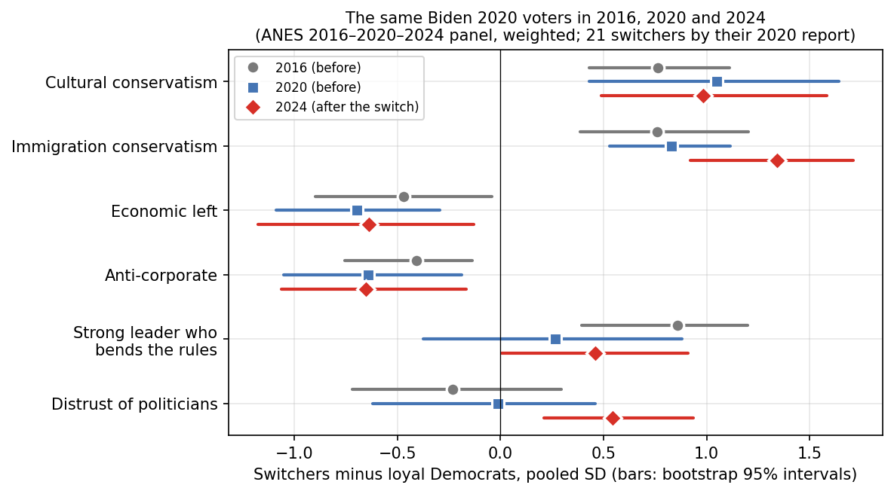

# 2024 DNC Campaign Autopsy: A Data-Driven Analysis

*Units of analysis range from the national election (Part 1) to the county (Parts 2–3, 6–7), the survey respondent (Parts 4–9, including a three-wave panel), the New York City election district (Part 10), and the House primary race and the news article (Parts 10–11) · Elections covered: 1948–2026*
*Data: MIT Election Lab · FRED · Census ACS · BLS QCEW · Gallup · USAspending · Cooperative Election Study (2016–2024 cross-sections and 2020–2024 panel) · ANES 2024 · Medill Local News Initiative · NYC and NYS Boards of Elections · NYC Campaign Finance Board · FEC · GDELT · New York Times Archive · public polling*

---

## Executive summary

Kamala Harris lost the 2024 presidential election with **49.25% of the two-party popular vote** (the vote split between the two major candidates only), down from Biden's 52.27% in 2020. Democrats received 6.25 million fewer votes than in 2020, in an electorate that was 3.3 million votes smaller overall.

This report asks why, in eleven parts. Parts 1–3 look at the national result and at counties: what conditions predicted, where votes were lost, and what kinds of places moved. Parts 4–9 look at individual voters in large surveys, including panels that interviewed the same people in 2016, 2020, 2022 and 2024: how they saw the economy, who switched, and what they believed. Parts 10–11 look at campaigns that ran explicitly on economics: New York City's 2025 mayoral race and insurgent left-wing House primaries.

A note on terms: a **switcher** voted Biden in 2020 and Trump in 2024; a **percentage point (pp)** is one point of vote share; "**share**" losses are voters choosing the other side, "**turnout**" losses are voters staying home. The synthesis at the end defines these more fully and explains how each finding was reached.

### The short version

- **Harris lost about as badly as conditions predicted — slightly less.** An unpopular incumbent party (38% approval) seeking an open seat was expected to lose; the campaign did not make it worse.
- **The loss that decided the election came from voters changing sides, not staying home.** Turnout fell mostly in safe Democratic states, where it changed nothing.
- **The voters who left agreed with Democrats on economics and with Republicans on immigration and culture.** Their cultural views were in place before they switched; their distrust of politicians came with the switch.
- **They did not see much economic difference between the candidates.** How people rated the economy tracked their party and their news sources, not their local economy.
- **The shift among poorer voters in 2024 was mainly a Hispanic shift, not a class one.**
- **Economic-left campaigns since 2024 have built durable bases among young voters, but have not yet won back the voters Democrats lost** any better than ordinary Democrats on the same ballot.
- **Some earlier figures on switching were too high.** Surveys that ask people in 2024 how they voted in 2020 overcount switchers; correcting this lowered switching rates by roughly a sixth to a fifth and changed one conclusion (Part 7).

### Findings by part

**Part 1 — The conditions predicted a narrow loss.** A model built on every election since 1948, using the economy and presidential approval, predicted Harris would win 47.9%. She won 49.25% — 0.8 to 1.4 points better than predicted in every version of the model, and within its margin of error in all of them. That margin (3.75 points) is inflated by one unusual data point, the 2020 pandemic collapse; without it the margin is 2.66 points.

**Part 2 — The shift was nearly universal.** 90% of counties and all 51 states (including DC) moved toward Trump. Of the votes Democrats lost nationally, about three-quarters (73%) came from people voting differently and a quarter (27%) from people not voting. The biggest raw losses were in Democratic strongholds, and there the cause was turnout.

**Part 3 — Poorer places have been drifting away from Democrats since 2012; Harris inherited the trend.** County income, education and racial makeup explain about 42% of the differences in how much counties swung. The gap between how Democrats do in rich and poor counties, compared with 2012, grew from 5.0 points in 2016 to 9.4 in 2020 and 9.9 in 2024 — so most of it was already in place before her campaign. Local manufacturing and wage growth during Biden's term explain essentially nothing.

**Part 4 — People's view of the economy came from their party, not their local economy.** How well a respondent's own county actually did explains 0.6% of the differences in how people rated the economy; their party explains 34%. Independents rated the 2024 economy worse than the 2020 pandemic economy. Among Biden voters, 28% of those who said the economy had gotten "much worse" voted Trump, against 1.1% of those who said "much better" (31.6% and 1.5% before correcting for misremembered 2020 votes). This link could run either way — a bad rating could cause a switch, or a switch could cause a bad rating — which Part 5 addresses. Nearly everyone agreed prices had risen (80% of Democrats, 95% of Republicans), but Republicans were twice as likely to say "a lot," and saying "a lot" predicted switching even among people who rated the overall economy the same. What news people consumed mattered; what local news was available did not.

**Part 5 — The bad economic rating came before the vote.** A panel asked the same Biden voters about the economy in 2022. Of those who said "much worse," 7.9% voted Trump two years later; of the 438 who saw improvement, none did. A rating given two years early cannot be an after-the-fact excuse for the vote. The same 2022 rating also predicted not voting at all, according to official voter records. Changes in each person's local economy still explained nothing.

**Part 6 — The shift among poorer voters was mainly a Hispanic shift, and federal money helped where it arrived.** Poor, mostly white counties moved toward Trump in 2016 and stayed there; in 2024 the movement came from poor counties that are mostly nonwhite. Among individual Biden voters, income did not predict switching (7.1% under $30,000, 6.4% over $200,000), but ethnicity did: Hispanic 10.5%, white 5.8%, Black 4.7%. These rates are probably about a fifth too high because they rely on people's memory of their 2020 vote. Separately, counties that received more Biden-era infrastructure and recovery money swung about half a point less toward Trump per standard deviation of spending — yet residents there did not rate the economy any better. The money moved votes without changing opinions.

**Part 7 — Turnout fell in safe states; the swing states were lost on people changing sides.** Democratic strongholds lost 2.9 million votes — 47% of the national Democratic loss — and 97% of that was in states that were not competitive. It was not a Democratic boycott: people of the same background stayed home at the same rate whether they had voted Biden or Trump in 2020; the Democratic coalition simply includes more of the groups that vote irregularly. Swing-state Democratic counties kept their turnout, and returning every stay-home to the polls flips no state under the straightforward estimate. Nationally, switchers to Trump outnumbered switchers to Harris about 2.6 to 1, and new voters leaned Trump. *Corrected:* an earlier version put this at 3 to 1, with switchers 60% and new voters 35% of the shift, and applied it to the "Blue Wall" states. Those figures relied on misremembered 2020 votes and national data; corrected, they are about 53% and 29%, and the split between the two cannot be pinned down.

**Part 8 — What the voters who left believed.** Switchers agreed with Democrats on economics — 77% wanted Medicaid expanded, and most wanted the wealthy taxed — but sided closer to Republicans on immigration (77% wanted the border wall, against 97% of loyal Republicans and 14% of loyal Democrats). In a model of who switched, cultural views mattered about 1.8 times as much as economic views, and immigration alone about 1.2 times — close to even. Measured with the same people's 2020 answers, culture's lead was at least as large, though too few switchers exist to pin down the exact ratio. Their views were in place before they switched: in 2020 they were already three times as conservative on immigration as other Biden voters, and the 17% of Biden's coalition holding those views went on to switch at six times the rate of everyone else (13.5% against 2.2%), supplying 56% of switchers. About a third of switchers (32%, by votes recorded at the time) had voted Trump in 2016, then Biden, then Trump again. Asked their top issue, switchers named prices twice as often as immigration, and 73% said Republicans would handle prices better. They were *not* more hostile to big business than loyal Democrats — the most anti-corporate Biden voters were the most loyal — which rules out the idea that they left because Democrats seemed captured by corporations. Following the same people from 2016 shows their cultural and immigration views came first, while their distrust of politicians appeared only in 2024. Until 2024 they liked the Democratic Party as much as loyal Democrats did (66–69 out of 100), and then their rating fell to 36. Biden voters who saw "no difference" between the parties mostly stayed home rather than switching.

**Part 9 — A large cross-pressured bloc voted Trump without seeing it as a vote against their economic views.** Between 13% and 20% of 2024 voters held left-leaning economic views and conservative cultural ones; they voted 57–68% Trump. Voters who were left on both voted 3–4% Trump. Before the election, switchers saw only half as much economic difference between Harris and Trump as loyal Democrats did, and most who placed themselves put themselves closer to Trump on economics (46 of 69). When leavers call the Democrats "too far left," they mainly mean culture: those who saw the party furthest to their left were the culturally conservative ones. Watching Fox News predicted switching even after accounting for views and party, though the survey measures cable news far better than online sources.

**Part 10 — New York City: the Trump-swing neighborhoods came back in 2025, but to every Democrat, not especially to Mamdani.** Harris carried the city 69–31; Mamdani won 51–41–7, with 732,000 fewer votes. In the mostly Hispanic and Asian, lower-income districts that had swung 24 points to Trump, Mamdani matched Harris's share (54%) and beat a Trump-endorsed Cuomo 58–42, while wealthy districts gave him 20 points less than Harris. But the comptroller and public advocate on the same ballot gained just as fast in those districts and ran 24 points ahead of Harris there — and the moderate Mikie Sherrill undid the 2024 swing across New Jersey the same day at least as fully. The swing-back was not a backlash to immigration enforcement: in New Jersey's most immigrant towns Republicans kept the usual off-year share of Trump's voters. Mamdani's primary win came from a different, younger coalition — primary turnout rose 36% in the youngest districts, where he won 69%, against 6–9% in the oldest — and he lost Black-majority districts to Cuomo 44–56. He was outspent 3 to 1 ($67 million to $23 million), including $21.9 million in outside spending against him, against a previous record of $1.0 million. His coverage was no more negative in tone than Adams's in 2021, but 3.4 times larger and framed differently by outlet. In 2026 his coalition reappeared for five other left candidates in the city's congressional primaries — his 2025 vote explains 90% of the district differences in theirs, and two unseated incumbents — but all ran behind him, and the Trump-swing districts moved further away. A durable base, not a growing one.

**Part 11 — Insurgent left candidates can beat money, but mainly one kind, and they have not grown primary turnout.** Across 133 Justice Democrats House candidacies from 2018 to 2026, democratic-socialist challengers to sitting Democrats were outspent all 8 times and won 6; more conventional progressive challengers won 2 of 13. In open seats, democratic socialists won 5 of 7, conventional progressives 14 of 50. Sitting Justice Democrats won all 25 re-elections in which they were not outspent and lost the 3 in which they were. On average, being outspent two to one costs about 5.5 points, and being a democratic socialist is worth about 6.5 points regardless of money. Insurgent races did not grow primary turnout beyond the national trend in any cycle. Hostile labels ("radical," "far-left") came mostly from right-leaning outlets: 2.9% of the articles, 41.5% of such headlines. The pro-Israel and crypto super PACs spent $93 million against Democrats in primaries from 2022 to 2026, yet in 47 documented ads mentioned Israel twice and crypto never, attacking instead on loyalty, character and performance. In 2026 their targets won 6 of 10 races (3 of 14 in 2022–24), but democratic socialists did not beat their spending by more than before (+3.5 against +3.6 points) — more wins, not bigger ones. Incumbents did worst in the youngest districts in 2026, a suggestive but not yet proven change. The short-lived committees that spent against left candidates in 2026 got 21.5% of their money from the same pro-Israel and crypto network and 40% from donors they don't disclose, against 0.5% and 8% for those backing left candidates. On YouTube, the left candidate drew more views on independent creator channels in 9 of 12 races.

### What this does not show

- **Parts 1–3 describe; they do not explain.** They show where the vote moved and what kinds of places moved most, not why individual people changed.
- **Part 4 cannot separate cause from effect** on its own: a bad economic rating and a Trump vote go together, but either could drive the other.
- **Part 5 rules out one objection, not all of them.** A rating given two years before the vote cannot be an excuse for it. But something else may already have been moving those voters in 2022, and the result rests on 39 switchers.
- **Switching rates from one-time surveys run high** because some people misremember their 2020 vote; the corrected figures are noted where they matter.
- **Parts 10 and 11 use neighborhood and district totals, mostly from primaries.** The voters Democrats lost mostly don't vote in primaries. Three tests on the November 2026 general election were written down in advance to address that.

---

## Part 1: Structural fundamentals

### Model

An incumbency-adjusted OLS regression on 19 presidential elections (1948–2020), following Abramowitz's "Time for Change" framework. The dependent variable is the incumbent party's two-party vote share. Predictors: Q2 real GDP growth in the election year (annualized, FRED GDPC1), the president's June Gallup approval, the number of consecutive terms the incumbent party has held, and whether the seat is open. The model is fit on 1948–2020; 2024 is strictly out-of-sample.

**Fit.** In-sample R² = 0.81; leave-one-out RMSE = 3.75pp. Approval (+0.27pp per point, *p* = 0.001) and GDP growth (+0.19pp per point, *p* = 0.04) carry the model. The open-seat penalty (−2.6pp) is marginal (*p* = 0.08) and consecutive terms (−0.4pp) is not distinguishable from zero (*p* = 0.55). An approval-only model achieves R² = 0.68 and predicts 48.1% for 2024. The fundamentals story is, in practice, an approval story.

### 2024

| Input | Value |
|---|---|
| Q2 2024 GDP growth (annualized) | +3.6% |
| Biden June 2024 approval | 38% |
| Consecutive Democratic terms | 1 |
| Open seat | Yes |
| **Predicted Harris two-party share** | **47.9%** |
| **Actual** | **49.25%** |
| **Residual** | **+1.4pp** |

The +1.4pp residual is less than half the model's out-of-sample error. Fourteen of the nineteen training elections have larger absolute residuals. The honest reading is that Harris performed about as a 38%-approval incumbent party should be expected to — not that she beat the fundamentals.

**Sensitivity.** 2020 is the model's largest miss by far (−10.9pp): COVID's −28% Q2 GDP predicted a Trump collapse that did not happen. That single observation suppresses the GDP coefficient. Refit without 2020, the GDP coefficient more than doubles (0.19 → 0.47), LOOCV RMSE falls to 2.66pp, and the 2024 prediction rises to 48.4% — residual +0.8pp. The conclusion is the same under either specification.

**Limitation.** Q2 GDP growth was strong in 2024, but real disposable income had only recently recovered from the 2021–23 inflation and consumer sentiment remained depressed. The model has no variable for the accumulated price-level shock, which is the most commonly cited economic grievance of the cycle. FRED consumer-sentiment and real-income series were pulled for this project and are the natural next test.

---

## Part 2: Where the votes went

### Data

County-level presidential returns from MIT Election Lab, 2016–2024. The raw file mixes reporting formats — some counties have a single TOTAL row, some report only by vote mode (absentee, election day, etc.), and some have both. The pipeline uses TOTAL where present and sums modes otherwise; the result matches certified national totals within 0.02M in every cycle. Alaska is excluded from county analyses because MIT codes it by state house district, which was redrawn in 2022. The county panel is 3,111 counties with complete 2016, 2020, and 2024 returns.

### Decomposition

Each county's change in Democratic votes is split into two parts:

```
ΔDem votes = dem_share_2020 × (total_2024 − total_2020)      [turnout component]
           + (dem_share_2024 − dem_share_2020) × total_2024   [share component]
```

The turnout component is the votes Harris would have gained or lost from turnout change alone, holding Biden's share. The share component is the rest. The share component **cannot** distinguish persuasion (voters switching parties) from differential mobilization (Democratic-leaning voters staying home at higher rates than Republican-leaning ones). That separation requires individual-level data.

### National picture

| | 2016 → 2020 | 2020 → 2024 |
|---|---|---|
| Change in Democratic votes | +15.4M | **−6.25M** |
| Turnout component | +10.6M (69%) | −1.7M (27%) |
| Share component | +4.8M (31%) | **−4.6M (73%)** |
| Change in total votes | +22.0M | −3.3M |

Biden's 2020 gain was mostly a turnout surge. Harris's 2024 loss was mostly share: the electorate shrank modestly, but the bigger effect was that the Democratic share of whoever did vote fell from 51.3% to 48.3%.

### Geography

| Metric | 2020 → 2024 | 2016 → 2020 (comparison) |
|---|---|---|
| Counties shifting right | **2,792 / 3,111 (90%)** | 1,594 / 3,111 (51%) |
| Median county swing (margin) | **−3.2pp** | −0.1pp |
| Turnout-weighted mean swing | **−4.9pp** | — |
| States shifting right | **51 / 51** | — |

The 2020 cycle was a wash at the county median with gains concentrated in suburbs; 2024 moved nearly everything. The largest state swings were in New York (−10.3), New Jersey (−10.0), Florida (−9.7), California (−9.0), and Texas (−8.1) — not the Midwest. The largest county swings (Bronx, Queens, Miami-Dade, Hudson NJ, Imperial CA, the Texas border) are heavily Hispanic urban and border counties.

### Strongholds versus everywhere else

Classifying the 2,439 counties that lost Democratic votes by which component dominates:

| Type | Counties | Share of Dem vote loss |
|---|---|---|
| Turnout-dominant (turnout component > 60% of loss) | 381 | **43%** |
| Mixed (both components negative) | 406 | 27% |
| Share-dominant (share component > 60% of loss) | 789 | 23% |
| Offsetting (one component positive) | 863 | 7% |

This looks like it contradicts the national picture, and the reconciliation matters. Share-dominant counties are twice as numerous, but turnout-dominant counties are the big Democratic ones — and 43% of all lost votes came from just 381 of them. The 60% cutoff is arbitrary and the shares move with it (49% at 55%, 19% at 65%), so the table is illustrative rather than a measurement. The regression in Part 3 is the sturdier evidence: a county's 2020 Democratic share strongly predicts its turnout loss (−1.7 votes per 100 per SD) and barely predicts its share loss (−0.2). **Democratic strongholds lost votes because their voters stayed home; everywhere else, the Democratic share fell.**

### The 2020 baseline

Biden's 2020 coalition was historically unusual: pandemic-era mail voting, the largest turnout surge in modern history, and peak anti-Trump mobilization in high-education suburbs. Some of the 2024 "turnout loss" in strongholds is the unwinding of that surge. The 2016 → 2020 comparison row above is the reminder that the 2020 starting line was itself an outlier.

---

## Part 3: Economic geography of the swing

### Regression

Merging Census ACS 2020 five-year county characteristics onto the county panel (N = 3,110), a WLS regression weighted by 2020 turnout explains **42%** of the variance in the 2020 → 2024 margin swing. The residuals are severely heavy-tailed (kurtosis 32), so the standard errors reported here are HC3 heteroskedasticity-robust, fit on the 2,817 counties with complete BLS data (97.7% of 2020 votes).

**Effect of a one-SD increase in each predictor on the county swing** (positive = toward Democrats):

| Predictor | Effect (pp) | 95% CI | |
|---|---|---|---|
| College share | **+2.4** | [+1.8, +3.1] | more college → smaller rightward swing |
| White non-college share | **+2.6** | [+1.7, +3.6] | more white non-college → smaller rightward swing |
| Log median income | **−0.8** | [−1.3, −0.2] | richer → larger rightward swing |
| Unemployment rate | −0.4 | [−0.8, +0.1] | not significant |
| Dem share 2020 | −0.4 | [−1.1, +0.2] | not significant |
| Manufacturing share 2016 | +0.2 | [0.0, +0.4] | marginal |
| Change in mfg share 2016–24 | 0.0 | [−0.2, +0.1] | null |
| Private job growth 2020–24 | **−0.5** | [−0.9, −0.1] | faster job growth → larger rightward swing |
| Real pay growth 2020–24 | +0.3 | [−0.2, +0.7] | null |

Three things to read carefully:

**The white non-college coefficient is positive.** Counties with more white non-college residents swung *less* to the right in 2024, holding income and education constant. This is the opposite of the 2016 pattern. Those counties had already moved; the 2024 shift was concentrated in diverse, lower-education, urban and border counties.

**The Biden-term economy did not register.** Real private-sector pay growth from 2020 to 2024, deflated by CPI, has no detectable relationship to the county swing. Counties where real pay rose swung the same as counties where it fell. Private job growth actually predicts a *larger* rightward swing — and the component regressions show why: job growth raises the turnout component (+0.8 per SD) and lowers the share component (−0.2). Those are Sunbelt growth counties gaining new, Republican-leaning voters, not existing voters rewarding the economy.

**Manufacturing exposure is not the story of 2024.** The 2016 manufacturing share of employment is marginally positive; its change since 2016 is exactly zero. Whatever the China-shock literature explains about 2016, it was fully priced into the 2020 baseline.

### The income gradient across cycles

Comparing each Democratic nominee's county-level vote share to Obama's 2012 share, by county income quartile, turnout-weighted:

| vs. Obama 2012 | Q1 (poorest) | Q2 | Q3 | Q4 (richest) | Q4 − Q1 |
|---|---|---|---|---|---|
| Clinton 2016 | −5.8 | −6.1 | −4.5 | −0.8 | **+5.0** |
| Biden 2020 | −6.3 | −4.3 | −1.8 | +3.1 | **+9.4** |
| Harris 2024 | −9.2 | −6.4 | −4.1 | +0.7 | **+9.9** |

Every Democrat since Obama has underperformed him in the poorest quartile, by a growing margin: −5.8, −6.3, −9.2. The gradient nearly doubled between 2016 and 2020 and then held. Harris's cycle is Biden's gradient shifted down roughly 2–3pp across all four quartiles. The class realignment is a ten-year trend, not a 2024 event.

Two things about this table are easy to misread, and Part 6 takes both up. The poorest quartile of counties casts 5.5% of the national vote. And "the poorest quartile" is not one population: it contains rural white Appalachia and the Rio Grande Valley, which moved in different years for different reasons.

### What "populism premium" this does and does not test

The hypothesis that working-class economic messaging earns votes in low-income counties cannot be tested with county returns alone: there is no measure of what voters heard or believed. What the data shows is that the local economic outcomes voters would be rewarding — real pay, jobs — had no effect, while the structural composition of a county — education, race, income level — had large ones. That is consistent with an attribution failure (voters did not credit the incumbent party for local improvement). It is equally consistent with national inflation swamping local conditions, or with the shift being cultural rather than economic. Part 4 takes this up with survey data linked to the same county records.

---

## Part 4: Did voters see the economy their county had?

### Data

The Cooperative Election Study (CES) surveys about 60,000 Americans each election year and records their county. The 2024 wave asks, before the election, whether "over the past year the nation's economy has" gotten much better through much worse, and, after the election, whom the respondent voted for and whom they recall voting for in 2020. Linking respondents to the county records from Parts 2–3 gives 56,635 people in 2,653 counties with both a measured local economic change and a stated perception of it.

### Local reality does not register

Regressing perceived economic change (−2 to +2) on the respondent's county's real pay growth, job growth, and unemployment over the Biden term:

| Predictors | R² |
|---|---|
| County economic record | **0.006** |
| Party identification (7-point) | **0.338** |
| Both | 0.341 |

The county record explains six-tenths of one percent. Within party the picture is flat: Democrats in counties where real pay fell the most rate the economy +0.34; where it rose the most, +0.36. Republicans, −1.31 and −1.43. A one-standard-deviation better local real-pay record moves perception by −0.02 (Democrats), −0.04 (independents), and −0.04 (Republicans) — tiny, and in the wrong direction; only the Republican estimate is statistically distinct from zero, and it says Republicans in counties where pay grew faster rated the economy slightly *worse*. Whatever voters were evaluating in 2024, it was not the economy of the place they live.

### The partisan flip, and who flipped less

| Perceived economy, mean (+2 … −2) | Democrats | Independents | Republicans |
|---|---|---|---|
| 2016 (Obama, D) | +0.43 | −0.44 | −0.65 |
| 2020 (Trump, R, pandemic) | −1.41 | −0.83 | +0.11 |
| 2024 (Biden, D) | +0.32 | −0.98 | −1.37 |

Out-party respondents rate the economy badly in every year; that is the known result. Two comparisons are specific to 2024. **Independents rated the 2024 economy worse than the 2020 pandemic economy** (−0.98 vs −0.83). And **the in-party did not fail to notice**: Democrats in 2024 rated Biden's economy (+0.32) *higher* than Republicans rated Trump's in 2020 (+0.11) and only modestly below Democrats' rating of Obama's in 2016 (+0.43). The disconnect between the economic record and its perception is not an in-party phenomenon. It sits with independents and with Republicans, whose −1.37 is within rounding of the −1.41 Democrats recorded for the pandemic year — the out-party rated the 2024 economy about as harshly as the out-party of 2020 rated the year of the COVID crash.

### The attribution gap and media diet

The *attribution gap* is how much better or worse a respondent rates the economy than their county's record predicts — the residual from the first regression above. Net of party identification, demographics, and county characteristics, the gap moves with what people watch and read:

| Media use in the past 24 hours | Effect on gap (scale points) |
|---|---|
| Watched MSNBC | **+0.59** |
| Read a newspaper | +0.30 |
| Watched CNN | +0.16 |
| Watched local TV news | +0.03 (n.s.) |
| Used social media | −0.05 |
| No news at all | −0.12 |
| Watched Fox News | **−0.32** |

For reference, one step on the seven-point party scale is −0.30. Fox viewing shifts Democrats who watch it by −0.67 and strong Republicans by −0.15 — either persuasion of the persuadable or a floor effect among those already at the bottom of the scale; the data cannot say which. Media choice is self-selected, so these are associations conditional on party, not effects of exposure.

### Media environment, as opposed to media diet, has almost nothing to explain

A multilevel model with respondents nested in counties puts a ceiling on how much any county-level factor — local news availability, media market, anything geographic — could matter. Only 4.7% of the variance in perceived economy is between counties at all, and after accounting for who lives in each county (party, education, age, race) that falls to 0.5%. A county two standard deviations above versus two below the average differs by 0.31 points on a four-point scale.

That ceiling was then tested directly against the Medill Local News Initiative's 2025 county inventory: 213 counties with no local news outlet, 1,526 with one. (Medill's own curated "news desert" label covers 206 counties and agrees with the zero-outlet count on 163 of them; every result below was run under both definitions and does not change.) Linked to the CES, that gives 547 respondents in news deserts and 8,003 in single-outlet counties. The news environment fails every test it was given:

| Test | Result |
|---|---|
| Does scarcity change what people consume? | Net of party, education, and rural status: newspaper −0.03 (SE 0.02), local TV −0.03 (0.02), Fox −0.02 (0.02). Only "no news at all" rises, by 1.8 points. |
| Does it explain between-county variance? | The news variables alone explain 12% of the 0.5% that remains after accounting for who lives in each county. The rural-urban code alone explains 30% of the same quantity; news adds about four points beyond a metro/nonmetro split. County composition explains 80%. |
| Direct effect on perception? | News desert +0.04 (SE 0.05). Watching Fox, for scale: −0.36. |
| Does it widen the partisan gap? | +0.02 (SE 0.02) — null, and the point estimate runs the wrong way. |
| Can it instrument for perception? | First-stage F = 0.6. No. |

Whatever produced the disconnect between perception and reality, it operated on individuals through the sources they chose, not on places through the sources available. The local news environment is not where the 2024 information problem lived.

The one thing county context does modulate is the size of the partisan gap: the distance between strong Republicans and strong Democrats is **−2.09 in counties with the most white non-college residents and −1.56 in counties with the fewest**. The partisan divergence in perception is a third wider in exactly the places Part 3 identified as structurally drifting — and news availability does not move it.

### The gap and vote switching

Among 2024 respondents who recall voting for Biden in 2020 and voted for a major-party candidate in 2024 (N = 20,608), 6.4% voted for Trump (weighted; 3.0% unweighted — the panel over-represents consistent Democrats and the weights correct for it, so the level depends on the weights more than most figures in this report). Split by how they rated the economy:

| "Over the past year the nation's economy has…" | N | Switched to Trump |
|---|---|---|
| Gotten much worse | 1,192 | **31.6%** |
| Gotten somewhat worse | 2,580 | 11.1% |
| Stayed about the same | 3,798 | 4.6% |
| Gotten somewhat better | 8,746 | 1.7% |
| Gotten much better | 4,292 | **1.5%** |

The relationship is monotonic across all five levels.

**Corrected for recall.** "Biden voters" here are people who *recall* voting Biden, and the CES panel shows about a quarter of recalled switchers had reported a Trump vote in 2020. Weighting each respondent by the panel's probability that they reported a Biden vote in 2020 (by recalled vote, 2024 vote and economy rating; appendix E.4a) lowers every rate by about a fifth: much worse **28.0%** (95% interval 16–39), somewhat worse 8.3%, the same 3.4%, somewhat better 1.2%, much better **1.1%**; overall 5.3% rather than 6.4%. The misclassified are spread evenly across ratings — they are not concentrated among the "much worse" — so the gradient survives intact, and the gap's coefficient in the full model is unchanged (−0.85 against −0.83; average marginal effect of a one-point-worse gap 3.4pp rather than 3.9). Controlling for party identification, education, age, race, media diet, and the county's actual economic record, a one-point-worse attribution gap raises the probability of switching by 3.9 percentage points. The county's real pay growth has no detectable effect (−0.011, SE 0.113). The mirror holds for recalled Trump voters: 2.3% switched to Harris, and the gap predicts it in the expected direction. A multilevel logit with a county random effect gives a similar coefficient (−0.96 vs −0.83).

**This is the finding that most needs a caveat.** Perception is measured before the election and vote after, but a voter who had already decided to leave Biden's coalition would rate the economy badly *because* of that decision. The association is consistent with misattribution driving the switch and equally consistent with the switch driving the rating. Nothing in the CES design separates the two. The obvious repair — use local news availability as an instrument for perception, on the logic that it shifts what people believe but not how they vote except through belief — was tried and does not work: the news environment barely moves perception at all (first-stage F = 0.6), so there is nothing to instrument with. What the data does establish is that the rating is not coming from the local economy, and that it is coming, in part, from media diet — which narrows the set of explanations without closing it.

### Prices: consensus on direction, partisanship on degree

The 2024 CES also asks whether "the prices of everyday goods and services" increased a lot, somewhat, stayed the same, or decreased. It is closer to a factual report than the economy rating, and it is less partisan — but not un-partisan, and the distinction matters.

| | Said prices rose | Said "a lot" | Of those who said rose, "a lot" |
|---|---|---|---|
| Democrats | 80% | **35%** | 44% |
| Independents | 90% | 62% | 69% |
| Republicans | 95% | **76%** | 80% |

On direction there is near-consensus: four in five Democrats and nineteen in twenty Republicans said prices went up. On degree there is not: Republicans were twice as likely as Democrats to say "a lot." Measured against each item's own spread, the Democrat–Republican gap is 0.74 standard deviations on prices, 1.26 on the economy rating, and 0.54 on the respondent's own household income. Prices sit between the abstract national question and the personal one — less filtered than "the economy," more filtered than "your income."

Price perception feeds the economy rating by the same amount for everyone: within each party, saying prices rose one step more lowers the economy rating by 0.53–0.58, and the party × prices interaction is zero (0.000, SE 0.007). Partisanship sets the level from which each respondent starts; reported price experience moves every group off that level by the same amount. Adding prices to party identification raises the explained variance in the economy rating from 34% to 44%.

Prices also predict switching on their own. Among recalled Biden voters, **12.8% of those who said prices "increased a lot" voted for Trump, against 3.6% of those who said "increased somewhat."** With the economy rating held fixed, one step more inflation reported raises the probability of switching by 1.9 points; without that control, by 5.1 — a bit under half the prices effect is direct, the rest runs through the general economy rating.

This does not resolve the reverse-causation problem and narrows it only somewhat. The margin that predicts switching — "a lot" versus "somewhat," among people who agree prices rose — is exactly the margin on which the parties differ, so a Biden voter who had already moved toward Trump could plausibly report "a lot" for the same reason they rate the economy badly. What the prices item adds is a second, less abstract measure that points the same way, with a partisan filter about 60% the strength of the economy rating's. Like the economy rating, it has no local component: county economic record and composition explain 2% of its variance.

### Reading Part 4 against Parts 1–3

Part 3 found that the local economic outcomes voters should have been rewarding had no effect on the county swing. Part 4 shows why: voters were not perceiving them. The individual-level gap predicts individual switching, but between-county variation in the gap barely exists, so it does not aggregate to a county-level relationship with the swing — the county-level gap has no detectable effect on the county swing (p = 0.8). The economy voters evaluated in 2024 was a national, partisan, and media-mediated object, not the one in their county's employment and wage records. Prices were the part of that object on which the partisan filter was weakest — all sides agreed they had risen, and reported price experience moved the economy rating through the same channel regardless of party — but how much they had risen was still read through a partisan lens.

---

## Part 5: The same voters, 2020 to 2024

### Data

The CES re-interviewed 6,175 of its 2020 respondents in 2022 and again in 2024. Each wave asked the same economy question. The 2020 vote was recorded in 2020 and the 2024 vote in 2024 — no recall. All three waves were matched to voter files, so turnout is validated by record. Retained panelists are older, more educated, and more often validated voters than the 2020 base, with no partisan difference in attrition; the panel under-represents the disengaged.

### The flip, within person

The partisan flip in Part 4 compared different samples in different years. Here it is the same people:

| Perceived economy (+2 … −2), 2020 party ID | 2020 (Trump) | 2022 (Biden, inflation peak) | 2024 (Biden) |
|---|---|---|---|
| Democrats (N = 2,912) | −1.52 | −0.49 | +0.34 |
| Independents (N = 895) | −0.98 | −1.18 | −0.81 |
| Republicans (N = 2,298) | +0.08 | −1.71 | −1.36 |

Sixty-one percent of Democrats moved two or more points toward their incumbent between 2020 and 2024; 46% of Republicans moved two or more points away. Independents barely moved. Composition cannot explain a within-person change. In 2022, at the inflation peak, Democrats rated their own president's economy at −0.49 — negative, but two full points above Republicans.

In first differences — each person's change in rating against their county's change in real pay — the county coefficient is −0.04 (SE 0.06) with party controlled, and within each party it is indistinguishable from zero. Local reality did not register in the cross-section, and it did not register within the same person over four years.

### Timing

Among 1,684 panelists who voted for Biden in 2020 and for Harris or Trump in 2024, 39 switched. By how they had rated the economy in 2022:

| "Over the past year the nation's economy has…" (asked in 2022) | N | Voted Trump in 2024 |
|---|---|---|
| Gotten much worse | 240 | **7.9%** |
| Gotten somewhat worse | 611 | 2.1% |
| Stayed about the same | 337 | 1.8% |
| Gotten somewhat better | 362 | **0.0%** |
| Gotten much better | 76 | **0.0%** |

Not one of the 438 Biden voters who saw improvement in 2022 voted for Trump. The coefficient on the 2022 rating is −1.1 to −1.4 across five specifications — alone, with party identification, with education and age, net of the same person's rating of Trump's economy in 2020, and expressed as the 2020→2022 *change* — and it moves by less than 0.2 between weighted and unweighted estimation. A one-step-worse rating in 2022 raises the probability of switching by about 8 points. The person's 2020 rating, given under Trump, has no independent effect.

This is the result the cross-section could not deliver. A rating given in autumn 2022 cannot be a rationalization of a vote cast in November 2024. The objection that decided switchers rate the economy badly *because* they have decided does not apply to a rating that predates the decision by two years. What survives is a narrower objection: a voter who was already leaving Biden in 2022 for reasons unrelated to the economy might have rated the economy worse for those reasons. That cannot be excluded with this design, and 39 events do not support the subgroup analysis that would probe it.

The 2022 prices item points the same way: among Biden voters who said prices had risen, 3.2% of those who said "a lot" switched against 0.3% of those who said "somewhat." Watching Fox in 2022 is associated with switching, but on 2 switchers among 38 viewers — not evidence.

### Demobilization, by record

The same 2022 rating predicts the other exit from the coalition. Among Biden 2020 voters matched to a voter file, the share with no validated 2024 vote runs from 9.0% ("much worse" in 2022) to 1.7% ("somewhat better"); the logit coefficient is −0.79 (p = 0.03) with party, education, and age controlled. Perception in 2022 predicted both switching and staying home in 2024.

The level of non-voting does not distinguish the coalitions: 3.9% of Biden 2020 voters and 4.2% of Trump 2020 voters had no validated 2024 vote. In this panel there is no differential demobilization — but the panel retained engaged voters, so both figures are floors. Part 7 returns to this with the much larger cross-section and confirms it: conditional on demographics, Biden and Trump 2020 voters stayed home at the same rate.

Among the 1,784 Biden 2020 voters with a known 2024 outcome (weighted): 92.9% voted for Harris, 2.9% for Trump, 1.0% for another candidate, 3.3% did not vote. In this engaged panel, defection to Trump and demobilization were the same size.

### Reading Part 5 against Part 4

Part 4 established the pattern; Part 5 establishes its timing. Perception of the economy — not the economy itself — moved with the vote, and it moved first. The county's economic record did not enter either the level or the change of what people believed. What entered was party, and within party, what people reported about prices and what they watched. By 2022 the Biden coalition's economic perception had already sorted its 2024 leavers from its stayers, on an item that has no local component and a partisan filter, before the campaign began.

---

## Part 6: Who moved, and did delivery register?

### The bottom quartile is two populations that moved in different years

Splitting the 778 poorest-quartile counties into terciles by nonwhite share, and tracking each against Obama 2012:

| Q1 counties | 2016 | 2020 | 2024 | Change 2020→24 |
|---|---|---|---|---|
| Mostly white (27% of Q1 votes; 79% white non-college) | −9.6 | −9.1 | −10.7 | −1.6 |
| Mixed (31%) | −6.3 | −6.2 | −8.4 | −2.1 |
| Heavily nonwhite (42%; 61% nonwhite) | −3.2 | −4.6 | −8.9 | **−4.3** |

White low-income counties moved nearly ten points in 2016 and then sat still through two more cycles. Nonwhite low-income counties barely moved in 2016, moved in 2020, and moved hardest in 2024. The largest Q1 counties by votes are the Bronx (−18 versus 2012), Hidalgo, Texas (−22), and Cameron, Texas (−18). The 2024 widening of the class gradient in Part 3 is the Hispanic and Black working class, not the white working class — the white working class had already gone.

### At the individual level, income does not predict defection; ethnicity does

Among 20,608 CES respondents who recall voting for Biden in 2020 and voted for a major-party candidate in 2024:

| Biden 2020 voters by family income | Switched to Trump |
|---|---|
| Under $30k | 7.1% |
| $30–50k | 6.0% |
| $50–100k | 6.3% |
| $100–200k | 6.3% |
| $200k+ | 6.4% |

| By race/ethnicity | Switched to Trump |
|---|---|
| Hispanic | **10.5%** |
| Other | 7.1% |
| White | 5.8% |
| Black | 4.7% |

Flat across income; the same by county income quartile; and inside the poorest counties, the residents under $50k switched *less* (5.3%) than those over (9.9%). Hispanic Biden voters defected at nearly twice the white rate in every income band; Hispanic voters under $30k, at 13.6%. *These rates use recalled 2020 vote. In the CES panel about a quarter of recalled switchers had reported a Trump vote in 2020, which lowers switch rates overall by about a fifth (Part 4, appendix E.4a); every rate in these two tables is probably high by roughly that much. Whether the error differs by ethnicity or income — which would change the comparisons, not just the levels — the panel cannot say: it has 44 recalled switchers in all.* In a model with party identification, education, age, and county income, Hispanic carries +0.59 (SE 0.24) and individual income −0.008 (SE 0.026).

Low-income Biden voters did rate the economy worse — +0.13 for the lowest band against +0.86 for the highest. The perception gradient by income exists. It did not translate into differential defection. The county-level class gradient is composition: the poorest counties are disproportionately Hispanic, and Hispanic Biden voters switched at elevated rates across the income range — above white voters in three of five bands and level with them in the other two ($30–50k and over $200k). (The panel has 38 Hispanic Biden voters and cannot check this.)

### Delivery moved the vote but not the perception

County obligations under the Infrastructure Investment and Jobs Act and the American Rescue Plan — the two most visible Biden-era programs traceable to a county in public spending data — per capita, log-scaled, top 1% winsorized, from enactment through Election Day 2024. Median IIJA obligations were $671 per resident; ARPA, $421. IIJA money was spread evenly across partisan lines ($1,023 per capita in Republican-leaning counties, $861 in Democratic); ARPA was not ($503 versus $1,843), so ARPA doubles as a proxy for urban Democratic counties and every model below controls for composition, the rural-urban code, and population.

| Test | IIJA | ARPA |
|---|---|---|
| County swing 2020→24, per SD of log per-capita obligations (Part 3 controls + rural-urban + population) | **+0.50pp** (SE 0.23) | **+0.43pp** (SE 0.17) |
| Same, dropping the top 5% of counties per capita | +0.55 (0.29) | +0.78 (0.30) |
| Residents' economy rating, with party and composition | +0.01 (0.01) | +0.00 (0.01) |
| Within-person change in rating, 2020→24, panel | +0.13 (0.08) | +0.02 (0.05) |
| Biden voter switching to Trump | −0.09 (0.13) | −0.13 (0.12) |

Counties that received more money swung less to the right — about half a point per standard deviation for each program, robust to every control and to dropping the counties where federal labs and state capitals inflate the figures. This is the first county-level economic variable in the project with the expected sign that survives everything.

But the residents of those counties did not rate the economy any better. ARPA per capita has a raw association with perception that is positive within every party; it disappears entirely once county income, education, and Democratic share are controlled, in both the cross-section and the panel. Delivery did not predict individual switching either.

Money that arrived in a county moved that county's vote without moving its residents' economic perception. The decomposition from Part 2 says which part of the vote it moved:

| Per SD of log per-capita obligations | IIJA | ARPA |
|---|---|---|
| Turnout component | −0.20 (0.23) | +0.19 (0.14) |
| Share component | +0.18 (0.11) | **+0.20 (0.07)** |
| Republican votes, % change 2020→24 | **−1.13 (0.41)** | −0.23 (0.49) |
| Democratic votes, % change | −0.05 (0.41) | **+0.56 (0.28)** |

Neither program moved total turnout. IIJA counties swung less right because Republican votes grew less there — Democratic votes were unaffected. ARPA counties swung less because Democratic votes held up better. Both are share-side effects: fewer new or switched Republican votes, not more Democratic mobilization. That rules out the organizing explanation. What is left is a share effect that does not run through belief about the national economy — a perception of *local* conditions that the survey item does not ask about, or something about the counties that received money that the controls miss. Whatever delivery did, it did not do it by making people believe the economy was better, and it did not do it by getting more Democrats to the polls.

---

## Part 7: Stronghold demobilization — how big, and did it matter?

Part 2 found that Democratic strongholds lost votes through turnout while the rest of the map lost them through share. This part sizes that loss, identifies who the stay-homes were, and asks whether their staying home changed any result.

### How big

| County type (2020 Dem share) | Share of 2020 votes | Dem vote change | Turnout change | Dem share change |
|---|---|---|---|---|
| Republican strongholds (<35%) | 19% | −0.16M | +2.1% | −1.1 |
| 35–45% | 16% | −0.29M | +1.2% | −1.6 |
| Competitive (45–55%) | 23% | −1.20M | −1.4% | −2.7 |
| Lean Democratic (55–65%) | 22% | −1.68M | −3.9% | −2.7 |
| **Democratic strongholds (65%+)** | **21%** | **−2.90M** | **−6.9%** | **−3.8** |

The 150 counties Biden won with 65% or more held 21% of all votes and 30% of Democratic votes. They lost **2.9 million Democratic votes** — from 24.7M to 21.8M, a 12% drop — while Republican votes in the same counties *rose* by 600,000. That is **47% of the entire national Democratic loss** and **68% of the national turnout component**. Turnout rose in Republican counties and fell in Democratic ones, monotonically across every bin.

The losses are where one would guess: Los Angeles (−612k, 380k of it turnout), Cook (−278k), Queens, Alameda, Santa Clara, Brooklyn, the Bronx. **2.81M of the 2.9M was in safe states**; California, New York, and Illinois alone account for 1.79M. The seven swing states together: −0.10M.

### Who stayed home: propensity versus effect

County returns cannot say who the missing voters were. The CES can: 34,666 respondents in 2024 were matched to the TargetSmart voter file, which records whether they voted, and reported their 2020 vote. Two different questions have two different answers, and keeping them apart is the whole finding.

**Propensity.** Conditional on who they are, was a Biden 2020 voter more likely to abstain in 2024 than a Trump 2020 voter? **No.** Unweighted, 5.7% of Biden voters and 5.6% of Trump voters had no validated 2024 vote. Split by demographic group:

| Group | Biden voters stayed home | Trump voters stayed home | Share of Biden voters |
|---|---|---|---|
| Black | 10.4% | 16.8% | 16% |
| Hispanic | 7.5% | 8.5% | 11% |
| Under 35 | 7.7% | 9.3% | 8% |
| No degree | 5.3% | 5.6% | 25% |
| Other | 3.2% | 4.4% | 41% |

Within every group, Trump voters stayed home as much or more. The panel, whose 2020 vote is contemporaneous rather than recalled, says the same: 3.2% of Biden voters and 3.7% of Trump voters. There is no evidence that Democrats who normally vote chose to sit out 2024 at a higher rate than Republicans who normally vote.

**Effect.** Did more 2020 Biden votes go missing than Trump votes? **Yes.** Weighted to the population — using `vvweight`, the CES's registered-voter weight — 8.0% of Biden voters and 5.9% of Trump voters did not vote. The two answers are consistent: the Democratic coalition contains more Black, Hispanic, and young voters, who vote less reliably in any year, and the survey weights turn that composition into an aggregate gap. The gap is a description of who Democrats are, not evidence that Democrats abandoned the party. County aggregates say the same thing from the other side: turnout fell 6.9% in Democratic strongholds and rose 2.1% in Republican ones.

### What 2016 shows

| County type | Turnout 2016→2020 | 2020→2024 | **2016→2024** |
|---|---|---|---|
| Republican strongholds | +14.7% | +2.1% | **+17.2%** |
| Competitive | +19.3% | −1.4% | +17.6% |
| Democratic strongholds | +14.4% | −6.9% | **+6.4%** |

Democratic votes in strongholds: 21.0M in 2016, 24.7M in 2020, 21.8M in 2024. Against 2016 the strongholds are up 3.6%. The "collapse" is the 2020 surge going back — but not symmetrically. Republican areas kept nearly all of their 2020 gain; Democratic areas kept a third. The 2020 surge in Democratic areas was disproportionately low-propensity voters pulled in by mail voting and anti-Trump energy, and in 2024 they reverted to baseline while Republican-area surge voters did not. That asymmetry is the real content of "demobilization."

### Stay home or flip?

Among Biden 2020 voters who did not vote for Harris:

| | Cross-section (N = 1,709) | Panel (N = 112) |
|---|---|---|
| Stayed home | 64% | 55% |
| Flipped to Trump | 30% | 31% |
| Third party | 6% | 13% |

Roughly two stay-homes for every flip, in both sources. Trump 2020 voters who left his column stayed home in even greater proportion — 76% — and flipped less (19%).

### The counterfactual

If every 2020 voter who stayed home in 2024 had voted as in 2020, using CES stay-home rates by state and 2020 vote applied to actual 2020 totals:

| | Trump margin | Unweighted (95% CI) | `commonweight` | `vvweight` |
|---|---|---|---|---|
| Michigan | −80k | +20k (−50k to +91k) | +51k | **+183k** |
| North Carolina | −183k | +59k (−6k to +123k) | +113k | +128k |
| Arizona | −187k | +24k | +11k | +27k |
| Georgia | −115k | −6k | +19k | +38k |
| Pennsylvania | −120k | −22k | −17k | −17k |
| Wisconsin | −29k | −12k | +7k | −10k |
| Nevada | −46k | −10k | −14k | +8k |
| National popular vote | −2.29M | +0.43M | +0.76M | +2.17M |

Michigan flips under the registered-voter weight and under nothing else, on 41 Biden and 24 Trump stay-homes in the sample; the unweighted interval spans zero. No other state comes close. The popular vote does not flip under any weighting. The stay-home rates are by recalled 2020 vote; corrected with the CES panel's recall rates (appendix H.5a) they barely move — stay-homes misremember their 2020 vote less than switchers do (98.9% of recalled Biden voters who stayed home had reported a Biden vote in 2020) — and no state's verdict changes: Michigan +23k unweighted, +57k `commonweight`, +181k `vvweight`. The one figure it nudges is the national net under `vvweight`, from +2.17M to +2.25M against the 2.29M deficit, with the correction's own uncertainty reaching +2.53M; under that weight alone the popular vote is at the edge rather than clearly out of reach. The cleanest reason nothing moves is in the county data: Democratic-leaning counties in the swing states did not lose turnout at all.

| Swing-state counties Biden won with 55%+ | Turnout change 2020→24 | Turnout component | Share component |
|---|---|---|---|
| Pennsylvania (5) | +0.1% | −3k | −37k |
| Michigan (5) | −0.1% | −2k | −71k |
| Wisconsin (6) | +3.5% | +23k | −9k |
| Georgia (23) | +1.3% | +19k | −3k |
| Arizona (4) | −0.8% | −3k | −19k |
| North Carolina (16) | +1.2% | +19k | −19k |

Philadelphia, Wayne, Milwaukee, Fulton, Maricopa held their 2020 turnout. The demobilization happened in Los Angeles and Brooklyn. In every swing state the loss came through share.

### How Republicans won the share

Share is a residual, and it bundles two things. Among validated 2024 voters with a known 2020 status:

| Bloc (2020 behavior) | Share of 2024 voters | 2024 vote | Net to Trump |
|---|---|---|---|
| Biden 2020 voters | 47.7% | 93.8% Harris / **5.2% Trump** | −42.3pp |
| Trump 2020 voters | 44.6% | 97.9% Trump / 1.6% Harris | +42.9pp |
| **2020 non-voters, new in 2024** | **5.6%** | **57.7% Trump** / 40.0% Harris | **+1.0pp** |
| 2020 third-party | 2.1% | split | +0.1pp |

Trump's margin among 2024 voters, about 1.8 points, is **+1.7pp from net switching** — Biden→Trump switchers outnumbered Trump→Harris switchers three to one — and **+1.0pp from new voters**, who broke 58–40 for Trump. Persuasion in the strict sense is about 60% of the share shift; Republican mobilization of people who had not voted in 2020 is about 35%.

**Those figures rest on recalled 2020 vote, and recall is wrong in both directions.** In the CES panel, which has each respondent's 2020 vote as reported in 2020, 7 of 25 people who recalled Biden and voted Trump had reported voting Trump in 2020; 22 of 59 who recalled not voting and voted Trump had reported voting Trump; 21 of 54 "new" Harris voters had reported voting Biden. Redistributing the cross-section by those rates (appendix H.7): net switching **+1.2pp** (95% interval 0.5–1.7) rather than +1.7, new voters **+0.6pp** (−0.5 to 1.7) rather than +1.0, and 2020 third-party voters, who went to Trump, +0.4pp. Biden voters switched at 4.1% rather than 5.2%, outnumbering Trump→Harris switchers 2.6 to 1 (1.7–3.6). Switching remains the larger piece at the point estimate — 53% of the shift against 29% for new voters — but the new-voter share is not distinguishable from zero or from switching, and new voters were 4.5% of the electorate, not 5.6%: four in ten of the recalled new voters had voted in 2020. Panelists recall better than fresh respondents, so if anything this understates the correction. The figures are national; the CES is not large enough to run the decomposition for Michigan, Wisconsin and Pennsylvania alone.

The new voters are the mirror of the demobilization story. They were young (mean age 39 against 53 for the electorate), 71% without a degree, and their vote split by group:

| New-voter group | Share of new voters | Trump | Harris |
|---|---|---|---|
| White/other, 30 and over | 48% | **71%** | 27% |
| Under 30 | 30% | 45% | 52% |
| Hispanic | 14% | **65%** | 34% |
| Black | 8% | 15% | 85% |

The non-college white and Hispanic marginal voter — the person who does not vote in most years — showed up in 2024 and voted Trump two to one. On the Democratic side the equivalent marginal voter, who had shown up in 2020, reverted to not voting.

### What it means

The low-propensity electorate changed sides. In 2020 the marginal voter was pulled in against Trump; in 2024 the Democratic-leaning marginal voter went home while the Republican-leaning one was pulled in. That is why Republican strongholds kept their 2020 surge and grew 17% over 2016 while Democratic strongholds gave theirs back. Demobilization was large in raw votes, real in effect, compositional in mechanism, and almost entirely in safe states. It was not Democrats who normally vote choosing to abstain. It did not touch the Blue Wall, where Democratic turnout held and the loss was share — voters who showed up and voted for the other side, and new voters who did the same. The popular-vote deficit is largely a demobilization story; the electoral college is not.

---

## Part 8: What the leavers believed

Part 7 identified the two groups that gave Republicans the share: Biden 2020 voters who switched, and 2020 non-voters who entered for Trump. The 2024 CES asks both groups what they think about healthcare, taxes, immigration, abortion, same-sex marriage, and policing, and where they place themselves, Harris, and Trump on a seven-point ideological scale. This part uses those items to test a specific hypothesis: that Harris lost economically-left but culturally-conservative voters by accepting a culture-war framing rather than pivoting to economic populism.

The CES cannot observe what Harris said, so "accepting a framing" is not directly testable. It can observe what the leavers believed, which axis of belief predicts leaving, and how far left they perceived Harris to be. It has no items on transgender policy, "wokeness," minimum wage, Medicare-for-all, tariffs, or issue salience (the ANES 2024 supplies those in the final section); the cultural axis here is immigration (five items), abortion and same-sex marriage (two), and policing (two), and the economic axis is Medicaid expansion, ACA repeal, Medicaid work requirements, student-loan forgiveness, corporate tax, tax on $400k+, the 2017 cuts, and low-income housing incentives.

### The leavers were economically available

Share taking the Democratic-aligned position, by path:

| | Loyal Democrats | **Biden→Trump** | **New voters → Trump** | Loyal Republicans |
|---|---|---|---|---|
| Expand Medicaid | 95% | **77%** | **73%** | 55% |
| Keep the ACA | 95% | 62% | 39% | 25% |
| Low-income housing incentives | 91% | 73% | 67% | 48% |
| Raise corporate tax to 28% | 91% | 60% | 41% | 23% |
| Raise taxes on $400k+ | 91% | 57% | 50% | 34% |
| Forgive student loans | 84% | 47% | 25% | 13% |
| *Economic index (0–1)* | *0.84* | ***0.55*** | ***0.44*** | *0.30* |
| Oppose the border wall | 86% | **23%** | **8%** | 3% |
| Allow asylum at the border | 64% | 18% | 9% | 6% |
| Oppose more border patrol | 33% | 8% | 5% | 2% |
| Legal status for long-employed immigrants | 86% | 43% | 41% | 25% |
| Abortion as a matter of choice | 93% | 46% | 29% | 21% |
| Federal recognition of same-sex marriage | 92% | 60% | 48% | 38% |
| *Cultural conservatism index (0–1)* | *0.27* | ***0.65*** | ***0.74*** | *0.83* |

Switchers sit between the parties on economics and close to Republicans on immigration. Three-quarters of Biden→Trump switchers support expanding Medicaid; 62% want to keep the ACA; majorities want higher taxes on corporations and the wealthy. On the wall, asylum, and border patrol they sit far closer to Republicans than to loyal Democrats, though not alongside them: 77% want the wall (loyal Republicans 97%, loyal Democrats 14%), 82% want asylum denied (94%, 36%), and 92% want more border patrol (98%, 67%). On abortion and same-sex marriage they are in the middle. New Trump voters are more conservative on both axes but still 73% for Medicaid expansion.

The hypothesis's first premise holds: the people who left agreed with Democratic economic positions, on the items the CES asks, far more than they agreed with Democratic positions on immigration.

### Which axis predicts leaving

Logit on Biden 2020 voters (N = 16,971; 327 switchers), with party identification, education, age, and race controlled:

| Per standard deviation | Coefficient | Marginal effect on P(switch) |
|---|---|---|
| Cultural conservatism | +2.03 (0.21) | **+7.6 points** |
| Economic-left position | −1.15 (0.19) | −2.2 points |

Cultural conservatism predicts switching at about **1.8 times** the marginal effect of economic views: logit coefficients of +2.03 and −1.15 per SD, and instantaneous average marginal effects of +4.8 and −2.7 points, in the same ratio. An earlier version of this report gave 3.5 times. That figure compared a one-SD step *toward* switching on the cultural index with a one-SD step *away* from it on the economic index, and with a base rate near 5% the second step runs into the floor; stepping both toward switching gives 2.2 times, both away 1.5 times. Splitting the cultural index — immigration +1.45 per SD, abortion and same-sex marriage +0.87, policing −0.02, against economics −1.25 in the same model — **immigration alone moves switching about 1.2 times as much as economic views**, abortion and marriage about 0.7 times, and policing not at all. Immigration is the axis that moved Biden voters, but not by the margin first reported: it and economic views were nearly co-equal forces pulling in opposite directions.

For new voters, economics and culture weigh nearly equally (economic −1.45, immigration +1.28, social +1.14), and being Black is by far the strongest predictor of not voting Trump (−2.87).

**Measured before the switch.** These attitudes are 2024 answers. The CES panel asks the same health-care, immigration, abortion and policing items in 2020 and 2024, so the same model can be fitted to the same 1,666 Biden voters twice, once on what they said in 2020 and once on what they said in 2024 (appendix I.10). On 2020 answers the cultural index outweighs the economic one about **3.2 times** (economic −0.41, cultural +1.32 per SD); on 2024 answers, 2.1–2.5 times. Immigration alone is 1.8 times economics before and 1.6–1.7 times after. The pre-switch ratio is not smaller than the published one, so the 1.8× figure is not an artifact of measuring after the vote. But no ratio is pinned down: with 37 switchers the bootstrap interval for the economic coefficient includes zero in every specification. What the panel does show clearly is what moved. The switchers' health-care positions moved right with their vote — Medicare for all from 79% to 47%, keeping the ACA from 71% to 50%, while loyal Democrats did not move — whereas on immigration switchers and loyal Democrats both moved right by similar amounts (+0.24 and +0.18). The 2024 economic coefficient is partly that movement. In 2020 these voters were more economically available than their 2024 answers suggest.

### The voter the hypothesis describes

Restricting to Biden 2020 voters who hold left economic positions (index ≥ 0.6) and splitting by cultural views:

| Biden 2020 voters, economically left | N | Switched to Trump |
|---|---|---|
| Culturally liberal, income under $50k | 4,668 | **1.8%** |
| Culturally conservative, income under $50k | 360 | **23.3%** |
| Culturally liberal, $50k+ | 9,409 | 1.8% |
| Culturally conservative, $50k+ | 369 | 20.7% |

Same economic views, thirteen times the defection rate, depending on cultural views — under $50,000 (23.3% against 1.8%), and nearly the same above it (20.7% against 1.8%, twelve times). The economically-left, culturally-conservative voter is 24% of switchers against 5% of loyal Democrats. That voter exists, was concentrated among leavers, and left.

### Harris was perceived as far left, and the perception tracked immigration

| | Placed themselves at | Placed Harris at | Called Harris "very liberal" | Distance to Harris | Distance to Trump |
|---|---|---|---|---|---|
| Loyal Democrats | 2.6 | 2.8 | 7% | 1.1 | 4.2 |
| **Biden→Trump** | **4.4** | **1.8** | **59%** | **3.0** | **1.6** |
| New voters → Trump | 5.3 | 1.3 | 85% | 4.2 | 1.1 |
| Trump→Harris | 4.3 | 2.5 | 20% | 2.1 | 2.6 |
| Loyal Republicans | 5.9 | 1.1 | 94% | 4.8 | 0.9 |

Switchers placed themselves in the middle of the scale and Harris between "very liberal" and "liberal" — 59% chose "very liberal," against 7% of loyal Democrats and 20% of the mirror-image Trump→Harris switchers. They saw Trump as nearly twice as close to them as Harris. Among switchers, calling Harris "very liberal" tracks immigration views (+0.14 per SD) and, inversely, economic views (−0.11); abortion and same-sex-marriage views do not predict it (+0.04).

### What this says about the hypothesis

Three of its parts are supported, one is complicated, and two are untestable.

**Supported.** The leavers held Democratic-aligned economic views — a majority of switchers wanted Medicaid expanded, the ACA kept, and the wealthy taxed. They held conservative cultural views. And they perceived Harris as very liberal, a perception that tracked immigration attitudes. The economically-left, culturally-conservative low-income voter the hypothesis names is real, was five times over-represented among switchers, and defected at 23%.

**Complicated.** The hypothesis is that an economic pivot would have kept those voters. The data says immigration attitudes were the stronger force on who actually left, but only somewhat — about 1.2 times the marginal effect of economic views, 1.8 times for the cultural index as a whole. That is a closer contest than it first appeared: an economic message would have had to overcome immigration, but not by a wide margin. Whether it could have is a counterfactual about salience that cross-sectional attitudes cannot resolve.

**Untestable here.** Whether Harris "accepted" a framing — the CES observes voters, not campaigns. And whether the culture-war issue was transgender policy or "wokeness" — the survey does not ask. What it does show is that among the cultural items it *does* ask, immigration carried most of the weight, abortion and marriage about half as much, and policing none. If the framing that stuck was a culture-war framing, on this evidence it was the border.

### Did the attitudes come first? The panel says yes, and then some

Part 8's attitudes are measured in 2024, after the switch. The panel asks the same four immigration items — legal status, border patrol, cutting legal immigration, the wall — in 2020, 2022, and 2024, to the same people.

| Immigration conservatism (0–1), same respondents | 2020 | 2022 | 2024 | Change |
|---|---|---|---|---|
| Biden→Harris (N = 1,645) | 0.17 | 0.24 | 0.34 | +0.18 |
| **Biden→Trump (N = 39)** | **0.50** | 0.55 | **0.74** | **+0.24** |
| Trump→Harris (N = 39) | 0.51 | 0.53 | 0.51 | 0.00 |
| Trump→Trump (N = 1,643) | 0.81 | 0.82 | 0.85 | +0.04 |

In 2020, before any of them had switched, the future switchers were already three times as immigration-conservative as the Biden voters who would stay — 72% opposed legal status for long-employed immigrants, a higher share than loyal Republicans (63%). Then they moved further: +0.24 by 2024, against +0.18 for loyal Democrats and +0.04 for loyal Republicans. Half of their 2024 distance from other Biden voters was there in 2020; the other half opened afterward. The attitude was a precondition and it also deepened. On 39 people the level difference is far outside sampling error; the movement is roughly ±0.15.

### Did the switch happen in 2016?

Three sources bear on this: the panel (2016 vote recalled in 2020, 39 switchers), the 2024 cross-section (2016 vote recalled in 2024, 334 switchers among 16,807 recalled-Biden voters), and the 2016 cross-section (2012 vote recalled in 2016, 2,121 Obama→Trump switchers).

**Where the 2024 switchers came from.** By recalled 2016 vote, in the 2024 cross-section:

| 2016 vote | Share of Biden 2020 voters | Share of 2024 switchers | Switch rate |
|---|---|---|---|
| Clinton | 70% | 37% | 2.7% |
| Did not vote | 18% | 24% | 6.8% |
| **Trump** | **4.5%** | **27%** | **32.2%** |

The 2024 switchers were a mix: a third had voted Clinton, a quarter had not voted in 2016, and **a quarter had voted Trump in 2016, gone to Biden in 2020, and gone back** — a group that is 4.5% of Biden's coalition and switched at 32%. The panel, on eight people, had put that last share at 4%; the cross-section supersedes it. An earlier version called 27% an upper bound, on the reasoning that recall drifts toward the current vote. The one source with a 2016 vote recorded in 2016 — the ANES panel — does not support that: by their 2016 reports, 32% of its 2024 switchers had voted Trump (10 of 21 unweighted; 95% interval 13–61%), Trump-2016 voters were 4.7% of Biden's coalition and switched at 27%, and recall understated them (six of the ten remembered it). The round-trippers are real and they are the single most defection-prone group in the coalition.

**Who entered in 2020.** The 2020 cross-section can profile the surge cohort — Biden voters who had not voted in 2016, 15% of his coalition — directly, with 4,077 of them:

| Biden 2020 voters by 2016 status | Immigration conservatism | Medicare-for-all | $15 minimum wage | Age | College | Party ID | Validated 2020 vote |
|---|---|---|---|---|---|---|---|
| Clinton 2016 (76%) | 0.18 | 87% | 92% | 51 | 45% | 1.8 | 77% |
| **Did not vote 2016 (15%)** | **0.21** | 88% | 89% | **36** | **24%** | **2.3** | **61%** |
| Trump 2016 (4%) | 0.41 | 76% | 75% | 48 | 36% | 4.0 | 60% |

The surge cohort was not culturally distinct — on immigration it was almost identical to the core of the coalition. It was young, poor, less educated, weakly attached, and forty percent of it cannot be found in a voter file. The Trump-2016 entrants, by contrast, were twice as immigration-conservative as the core and in the middle on party identification.

**The reservoir.** What distinguishes the switchers is not which cohort they came from but a single attribute that cut across all three: immigration conservatism. In 2020, **19% of Biden's coalition held conservative positions on immigration** — 17% of the Clinton cohort, 24% of the surge cohort, 50% of the Trump-2016 entrants — and those voters supported Medicare-for-all at 82% overall (76% in the Trump-2016 cohort, 83–86% in the other two).

In the 2024 cross-section, Biden 2020 voters who are immigration-conservative *as measured in 2024*:

| Biden 2020 voters (2024 attitudes) | Share of coalition | Switched to Trump | Share of all switchers |
|---|---|---|---|
| **Immigration-conservative** | **19%** | **22.0%** | **81%** |
| Not | 81% | 1.2% | 19% |

Within that group, Hispanic and white Biden voters switched at 23–24%, Black at 15%, and all supported Medicaid expansion at 78–92%. The result is not an artifact of where the line is drawn — a cutoff of 0.6 gives identical figures, 0.8 gives 7% of the coalition switching at 36%. And it is not weak partisanship in disguise: the ratio holds at every level of party identification, from strong Democrats (3.7% vs 0.2%) through weak and leaning Democrats (9.4% vs 0.8%) to independents who had voted Biden (46% vs 3%). What the party split does show is that the 22% average is carried by independents and leaners; among strong Democrats the reservoir defected at under 4%.

Those attitudes are measured after the vote. The panel can define the same reservoir on **2020** attitudes and follow it to 2024: 17% of Biden's coalition, switching at 13.5% against 2.2% — a six-fold ratio, on 23 events — and supplying 56% of the switchers. That is the pre-switch version, and it is the one to cite as predictive. The gap between it and the 2024-attitude version (18×, 81%) is the attitude movement that came with the switch, which the panel measured directly at +0.24 on the immigration index.

The economically-left, immigration-conservative Democrat was a fifth of Biden's coalition before 2024. Measured before the fact, that fifth was six times as likely to leave as the rest and produced more than half of the leavers; measured after, four-fifths.

### So: was it 2016?

Yes and no, and the distinction matters.

**Yes:** 2016 was the larger realignment of this voter type, by a factor of two. The Obama→Trump switchers were the white working-class version — 80% white, 23% college, wanting a $12 minimum wage and the end of Obamacare, and — for three in ten — voting for Trump in the primary before they voted for him in November. And a quarter of the 2024 switchers were people who had switched in 2016, returned to Biden in 2020, and switched again.

**No:** three-quarters of the 2024 switchers had not voted Trump in 2016. They were Clinton voters and 2020 entrants who shared the 2016 switchers' profile — economically left, immigration-conservative, in the ideological middle — but had stayed in or joined the Democratic coalition through 2020. The realignment did not happen once in 2016 and echo. It happened in 2016; 2020 reversed a piece of it and added a cohort of young, weakly attached, economically left voters who were not culturally distinct; and 2024 took the immigration-conservative fifth of the whole coalition — old core, new entrants, and round-trippers alike.

**On Sanders:** the pathway exists in the data — 288 respondents who voted Obama, then Sanders, then Trump, with exactly the profile — and it is 15% of the 2016 switchers, not the story.

### What the leavers said mattered

The CES measures positions, not priorities. A voter can hold Republican views on the wall and still vote on groceries. The ANES 2024 Time Series (5,521 respondents; 69 Biden→Trump switchers, 198 new Trump voters, 166 new Harris voters) asks the open-ended "most important problem facing the country," rates ten issues for importance, and asks which party would handle each better. It is a small sample and every switcher figure below carries a ±10-point interval, but it answers the question the CES cannot.

**The switchers' problem was prices, not immigration.** Asked to name the single most important problem, 35% of the Biden→Trump switchers named the economy or prices — inflation alone 29% — against 16% immigration. New Trump voters split 34% to 20%. Loyal Trump voters, by contrast, split evenly, 31% each. Loyal Democrats named neither: 30% named the state of politics itself (politicians, division, corruption) and 18% the economy. Across up to three mentions, 60% of switchers raised prices and 36% immigration.

The closed-ended battery says the same. Sixty-four percent of switchers called the cost of living "extremely important"; 34% said so of illegal immigration. Asked the two side by side, 38% of switchers rated the cost of living the more important, 57% rated them equal, and **4.5% rated immigration higher** — fewer than among loyal Democrats. Among new Trump voters the immigration-first share was 15%. The immigration-first voter is a loyal Republican (13%) or a Trump→Harris crosser (17%), not a leaver.

| | Loyal Democrats | **Biden→Trump** | **New → Trump** | Loyal Republicans |
|---|---|---|---|---|
| Most important problem: economy/prices | 18% | **35%** | **34%** | 31% |
| Most important problem: immigration | 3% | **16%** | **20%** | 31% |
| Most important problem: politics/democracy | 30% | 6% | 8% | 10% |
| Cost of living "extremely important" | 54% | 64% | 74% | 71% |
| Illegal immigration "extremely important" | 20% | 34% | 61% | 72% |
| Rates immigration above cost of living | 6% | **4.5%** | 15% | 13% |
| Republicans better on cost of living | 9% | **73%** | **83%** | 91% |
| Republicans better on illegal immigration | 18% | 87% | 86% | 94% |
| *N* | *1,945* | *69* | *198* | *1,437* |

**And they had concluded the Republicans would handle prices better.** Seventy-three percent of switchers and 83% of new Trump voters said Republicans would do the better job on the cost of living; 11% and 2% said Democrats. That is the hypothesis's "conceded framing" measured directly — not that the switchers wanted Republican economics (46% still preferred a government insurance plan and 44% a higher minimum wage, against 17% and 34% of loyal Republicans), but that on the problem they named, they no longer believed the Democrats were the party to solve it. The caveat is that the ownership item is asked after the vote and a Trump voter will credit Republicans on most things; switchers also gave Republicans crime (81%) and, at 43% to 36%, abortion. The prices judgment is not cleaner than the vote it follows.

**What distinguished them was still cultural and anti-elite, not the salience of immigration.** On the ANES's own batteries, the switchers sat 1.1 pooled standard deviations to the right of loyal Democrats on cultural items (transgender bathrooms and sports, campus DEI, diversity, marriage, abortion), 0.9 on anti-elite items (government run by a few big interests — 95% of switchers — corruption, distrust, "officials don't care," a strong leader who bends the rules — 58% agreed, against 24% of loyal Democrats), 0.9 on immigration, and 0.7 to the *left* of Republicans on economics. In a model of switching among Biden 2020 voters, cultural conservatism and anti-elite attitude carry the largest coefficients, immigration position about half as much, and economic views run the other way. Naming immigration or prices as the most important problem each roughly triples the odds of switching over holding the position alone. Among Biden voters who were immigration-conservative, those who also named immigration as the country's problem switched at 21%; those who did not still switched at 12.5%; immigration-liberal Biden voters switched at 2%.

So the ANES splits the hypothesis. The half that says the leavers were voting on the economy is right: they said so, two to one over immigration, and on that issue they had come to prefer the other party. The half that says the culture war was the concession is right about *who* left — the culturally conservative and anti-elite fifth — but not about what they said they were voting on: culture-war issues were 5% of switchers' most important problems, and they rated abortion, democracy, and racial inequality as less important than loyal Democrats did on every count. The switcher profile is a voter who held conservative cultural and immigration views, distrusted the political class, wanted more government in healthcare and wages, thought the problem was prices, and thought the Republicans would fix it.

### Was it corporate capture?

A sharper version of the anti-elite reading: the leavers saw the Democratic Party as beholden to corporate and moneyed interests, lost trust in it on the economy for that reason, and went to the candidate who at least claimed to fight the elite. The ANES can separate anti-*corporate* sentiment (a big-business thermometer, "because of the rich and powerful it's difficult for the rest of us to get ahead," a millionaire tax, limits on campaign spending, a labor-union thermometer) from anti-*politician* sentiment (government run by a few big interests, corruption, distrust, officials don't care) and from what might be called the strong-hand items (a leader who bends the rules; business leaders instead of politicians). It can also say what the leavers thought of the Democratic Party before they voted, and whether they saw the parties as too far apart or not far enough.

**The anti-corporate Democrats stayed.** On every anti-corporate item the switchers were *less* hostile to concentrated wealth than the Democrats who stayed: they rated big business 50 on the thermometer against 38, agreed that the rich and powerful block everyone else at 32% against 49%, favored a millionaire tax at 70% against 88%, campaign-spending limits at 52% against 79%, and rated unions 56 against 71. Sorted into thirds on the anti-corporate index, Biden 2020 voters in the most anti-corporate third switched at 1.5%; in the least anti-corporate third, 8.0%. A quarter of the switchers agreed that the country would be run better by business leaders than by elected politicians, against 5% of loyal Democrats. Net of economic, immigration, and cultural positions, anti-corporate sentiment does not predict switching at all; a warmer view of big business predicts *more* of it.

| | Loyal Democrats | Biden→stayed home | **Biden→Trump** | New → Trump | Loyal Republicans |
|---|---|---|---|---|---|
| Big-business thermometer | 38 | 43 | **50** | 49 | 53 |
| "Rich and powerful block the rest" (agree) | 49% | 45% | **32%** | 32% | 18% |
| Millionaire tax | 88% | 67% | **70%** | 55% | 38% |
| Campaign-spending limits | 79% | 54% | **52%** | 55% | 67% |
| Business leaders should run things | 5% | 10% | **25%** | 15% | 19% |
| Strong leader who bends rules | 14% | 26% | **47%** | 44% | 55% |
| Never trust government | 5% | 13% | **21%** | 22% | 21% |
| Democratic Party thermometer, *pre-election* | 73 | 62 | **36** | 22 | 15 |
| Sees the Democrats to the left of self (points) | +0.2 | +1.1 | **+2.3** | +4.5 | +6.3 |
| "No difference" on own most important problem | 27% | **48%** | 27% | 14% | 8% |
| *N* | *1,945* | *142* | *69* | *198* | *1,437* |

What separated the switchers from the Democrats who stayed was not hostility to corporate power but the strong-hand and distrust items — 1.2 pooled standard deviations on the former, 0.5 on anti-politician sentiment, and *minus* 0.8 on anti-corporate sentiment. In a model with all three families and the three position indices, the strong-hand index and cultural conservatism carry the weight; anti-corporate sentiment is zero.

**They thought the Democrats had moved left, not sold out.** Asked before the election, the switchers rated the Democratic Party 36 out of 100 — 42% put it at 30 or below — against 73 among Democrats who stayed. Asked after, they placed the party 2.3 points to the *left* of themselves on a 0–10 scale; 57% saw it to their left, and 53% placed themselves closer to the Republicans than to the Democrats. They did not see the parties as the same: only 27% said "no difference" on their own most important problem, exactly the loyal-Democrat rate, and 70% said Republicans. That is transferred faith, not lost faith.

**The lost-faith voters are the ones who stayed home.** The 142 Biden 2020 voters who did not vote in 2024 are the group the capture story describes: they rated the Democrats 62 before the election (not 36), placed the two parties 0.9 points apart on left-right (the switchers put them 3.3 apart, loyal Democrats 4.1), and on their own most important problem said "no difference" at 48%. They are moderately anti-corporate (index 0.60, between the loyal 0.73 and the switchers' 0.54), moderately distrustful, and not strong-hand voters. Part 7 showed the stronghold turnout collapse was compositional rather than a Democratic propensity to abstain; this is the attitudinal face of the same group — voters who did not see a party worth voting for, not voters who had chosen the other one.

**On the "moderate."** Nearly half the switchers (48%) and 43% of loyal Democrats place themselves in the center of the left-right scale, so self-labelled moderation does not distinguish them. Their positions do. Centrist switchers favored government health insurance at 38% and a higher minimum wage at 50%; centrist Democrats who stayed, 58% and 75%. The centre the party would need to court to recover these voters is not an economic centre; on economics the leavers sat to the right of the Democratic centrists who stayed, and on culture and immigration well to the right of them.

So the ANES answers the capture hypothesis in its strong form with a no: the voters most convinced that concentrated wealth rigs the game were the most loyal Democrats in 2024, and the voters who left were warmer to big business, colder to unions, and wanted a strong hand. What it leaves open is the stay-home group, which is where a "the Democrats don't fight for people like me" story has a foothold — a smaller group, and one Part 7 found did not decide any state.

### Before the switch: the same voters in 2016 and 2020

Everything above in the ANES is measured in 2024, after the vote. The ANES re-interviewed 2,171 people it had first interviewed in 2016, in 2020 and again in 2024, and asked them the same questions each time: trust in government and the "big interests," a strong leader who bends the rules, big business, the millionaire tax, the scales on services, health insurance and jobs, the wall, Dreamers, birthright citizenship, immigration levels, abortion, marriage, gay adoption and job protection, transgender bathrooms. Among them, 877 said in their 2020 post-election interview that they had voted for Biden; **21 of those voted for Trump in 2024**, 856 for Harris, and 64 stayed home. Twenty-one is small — with the weights, about eleven respondents' worth of information — so the intervals below are wide, and the unweighted figures, which tell the same story, are in the appendix (I.9).

| Switchers minus loyal Democrats (pooled SD) | 2016 | 2020 | 2024 | Full ANES 2024 |
|---|---|---|---|---|
| Cultural conservatism | +0.76 | **+1.05** | +0.98 | +1.06 |
| Immigration conservatism | +0.76 | **+0.83** | +1.34 | +0.92 |
| Economic left | −0.47 | **−0.70** | −0.64 | −0.67 |
| Anti-corporate | −0.41 | **−0.64** | −0.65 | −0.78 |
| Strong leader who bends the rules | +0.86 | +0.26 | +0.46 | +0.99 |
| Distrust of politicians | −0.23 | **−0.01** | +0.54 | +0.54 |



**The positions came first.** In 2020, while voting for Biden, the future switchers were already as far from loyal Democrats on cultural questions as they would be in 2024 — on the 0–1 index they sat at 0.42, loyal Democrats at 0.13, Trump voters at 0.49 — and three-quarters as far in 2016. On immigration about 60% of the 2024 gap was there in 2020 and the rest opened with the switch (+0.43 SD of movement relative to loyal Democrats, the same half-and-half the CES panel found). On economics they were to the right of loyal Democrats before as after, halfway to the Republicans and no further. Measured in 2020, immigration, cultural and economic views each predicted the 2024 switch by similar amounts (+0.85, +0.81 and −0.81 per SD); in the top third of the 2020 immigration index 9.5% switched, in the bottom third none did. The switchers did not rationalize their way into their cultural and immigration views after voting for Trump. Their economic views are a different matter: on the ANES's general economic scales they did not move, but on party-coded health-care items the CES panel shows them moving right with the switch (next paragraph and Part 8, "Which axis predicts leaving").

**The anti-corporate gap came first too, and ran the other way.** The future switchers were less hostile to big business and less keen on a millionaire tax than loyal Democrats in 2016 and in 2020, by as much as in 2024. The capture reading fails before the switch as it fails after it: in 2020 the least anti-corporate third of Biden voters went on to switch at 8.4%, the most anti-corporate third at 0.8%.

**The distrust did not.** In 2016 and 2020 the future switchers trusted government and politicians exactly as much as loyal Democrats did; the gap of half a standard deviation appears only in 2024. Trust in Washington follows who runs it — under Trump, Democrats of every kind distrusted it; under Biden, the loyal ones recovered and the leavers did not — so the anti-politician gap is better read as part of the switch than a cause of it. Anti-politician attitudes measured in 2020 predict nothing about 2024 (−0.01 per SD). The strong-leader item behaves the same way: a large gap in 2016, an indistinguishable one in 2020 after four years of Trump, a moderate one in 2024. The disposition behind it, measured by the four child-rearing items, is more stable (+0.45, +0.57, +0.39).

**They did not dislike the party.** The future switchers rated the Democratic Party 66 in 2016 and 69 in 2020 — loyal Democrats 69 and 70. The 36 they gave it in 2024 is new. What set them apart before was a warmer view of the other side (Republican Party 42 and 39, against 25 and 17) and weaker attachment (party identification about 3 on the 7-point scale, a leaning Democrat, against 2). They were cross-pressured partisans whose tie to the party held in 2020 and broke by 2024, not voters long alienated from it.

**Recall.** The ANES 2024 defines switchers by recalled 2020 vote. In the panel, recall is wrong often enough to matter for a group this small — of 26 people who recalled Biden and voted Trump, 12 had not reported a Biden vote in 2020, and 7 of the 21 true switchers did not recall one — but the misclassified look like switchers on every attitude, and the 2024 gaps for the two definitions agree within 0.15 SD. The profiles in the preceding sections are not an artifact of recall. The CES cross-section has the same problem at a smaller scale: in the CES panel, 23% of the voters who recalled Biden and voted Trump had reported voting Trump in 2020, and recall put the switch rate at 4.7% against a true 4.1%. Unlike the ANES case, these misclassified voters look like Trump voters (party ID 5.3), so they widen the apparent economic gap between switchers and loyal Democrats; the immigration profile is unchanged (88% immigration-conservative either way). The cross-section's 5.2% switch rate and its switcher counts are probably overstated by a sixth or more — fresh respondents recall less reliably than panelists who had answered the question twice before.

### Reading Part 8 against Parts 4 and 5

Parts 4 and 5 found that leavers rated the economy badly, that the rating was set by 2022, and that it did not track local conditions. Part 8 finds that the same leavers held left economic views. Those are compatible: a voter can want Medicaid expanded and believe the economy under Biden was bad. The link between them — an economically-left voter who rates the incumbent's economy badly, sees the incumbent's successor as very liberal, and holds Republican views on immigration — is the profile of the 2024 switcher, and it is the profile of a voter reachable on economics who was not reached.

---

## Part 9: What moved voters Republican, 2016–2024 — and what "left" means to them

Parts 8 established, one election at a time, that the voters who left the Democratic coalition held left economic views and conservative cultural ones. This part puts the two elections side by side and asks three questions that bear on what the party does next. How large is the electorate that agrees with Democrats on economics and votes Republican anyway, and what holds it there? Did voters see an economic difference between Harris and Trump at all, or only a cultural one? And when a voter says the Democrats are "too far left," what are they measuring?

### The cross-pressured fifth

Sorting the 2024 electorate by whether a voter holds the Democratic-aligned position on a majority of the eight CES economic items (Medicaid expansion, keeping the ACA, taxing corporations and incomes over $400k, and so on) and on a majority of the nine cultural items (immigration, abortion, marriage, policing):

| 2024 electorate | Share | Voted Trump |
|---|---|---|
| Economically left, culturally liberal | 43% | **3.8%** |
| **Economically left, culturally conservative** | **20%** | **67.6%** |
| Economically right, culturally conservative | 36% | 98.8% |
| Economically right, culturally liberal | 1% | 44% |

Sixty-three percent of voters held left economic positions. A fifth of the electorate held them *and* held conservative cultural positions, and that fifth voted two to one for Trump. The size of the cell depends on where the line is drawn: counting a voter who splits the eight economic items four-four as "left" (the table above) gives 20% voting 68% Trump; excluding ties gives 13% voting 57% Trump. Between an eighth and a fifth of the electorate, then, and it is the whole of the cross-pressured vote: 30% of Trump's 2024 voters were economically left, and 89% of those were culturally conservative. Among economically-left voters, immigration predicted a Trump vote at 1.6 times the marginal effect of abortion and marriage and four times that of policing.

The pattern is visible item by item. Three-quarters of voters wanted Medicaid expanded, and 38% of them voted Trump. Sixty-three percent wanted taxes raised on incomes over $400k; 29% of them voted Trump. Seventy percent backed low-income housing incentives; 37% voted Trump. Compare the immigration items: 44% opposed the wall, and 5% of them voted Trump; 35% would allow asylum, and 10% voted Trump. A Democratic economic position was held by a majority and split; a Democratic immigration position was held by a minority and sorted.

The same sort was present in 2016. The 2016 CES asks only two economic items (keep the ACA, a $12 minimum wage), so the cells are not comparable in size; on the pattern, economically-left cultural liberals voted 15% Trump in 2016 and economically-left cultural conservatives 58%, against 4% and 68% on the 2024 items. Read as a direction rather than a measurement, the party consolidated the culturally liberal part of its economic base and lost more of the culturally conservative part; the two-item 2016 index is too coarse to put a number on how much. The Republican base, for its part, is not cross-pressured: the 36% of the electorate that is economically right and culturally conservative voted 99% Trump, and by its own positions is not voting against its economic interest.

### Did they see an economic difference?

The ANES asks respondents, before the election, to place themselves, Harris, and Trump on the same seven-point scales — government versus private health insurance, government services, guaranteed jobs and income, and abortion. That makes it possible to ask whether the economic contrast between the candidates was perceived at all.

For the electorate as a whole it was. Seventy-one to 73% placed Harris to the left of Trump on each economic scale, against 78% on abortion; 8–12% put them at the same point; the mean perceived gap was 2.4–2.8 points on the economic scales and 3.3 on abortion. Most voters saw the candidates as further apart on abortion than on economics, but not by much, and most saw an economic difference.

The leavers saw half of it. Biden 2020 voters who stayed with Harris saw a 3.4-point economic gap between the candidates; those who switched to Trump saw 1.7, and the abortion gap they saw (2.9) was closer to the loyal Democrats' (4.0). Only 43% of switchers placed Harris on the government-insurance side of the scale (62% of loyal Democrats did), and only 54% placed Trump on the private side (84%). Asked to place themselves, **two-thirds of the switchers who placed themselves and both candidates on all three economic scales (46 of 69) put themselves closer to Trump than to Harris** — against 7% of the Democrats who stayed. The placements show why: switchers put themselves near the midpoint of the economic scales (3.7, 3.7, and 4.2 on health insurance, services, and jobs, where 1 is the government pole), Harris at about 3, and Trump at 4.4–4.9. Loyal Democrats put Trump at 6.1–6.3. The switchers were not reading Trump as a small-government conservative; they were reading him as a centrist a point to their right, and Harris as a point to their left. New Trump voters saw a similarly compressed gap (1.6). In a model of switching, the perceived economic gap predicts staying, net of the voter's own positions; the perceived abortion gap does not.

| Biden 2020 voters, pre-election placements | Stayed with Harris | Stayed home | **Switched to Trump** |
|---|---|---|---|
| Perceived Trump − Harris gap, economic scales | 3.4 | 2.3 | **1.7** |
| Perceived gap, abortion | 4.0 | 3.4 | 2.9 |
| Placed Harris on government-insurance side | 62% | 50% | **43%** |
| Placed Trump on private-insurance side | 84% | 65% | **54%** |
| Placed self closer to Trump than Harris on economics (all three scales placed) | 7% | 15% | **67%** |

Two readings are possible and the data does not choose between them. One: the switchers had already decided by the pre-election interview and placed Trump nearer to themselves for that reason. Two: the economic contrast that loyal Democrats saw was not landing with the voters who were leaving — Trump was seen as an economic centrist, a point and a half nearer to them than loyal Democrats placed him — and they voted, by their own map, for the candidate nearer to them on economics as well as on culture. Either way, a majority of the leavers did not experience their vote as a choice against their economic views. That is a different problem from the one the "voting against their interests" framing describes, and it is a communication problem before it is a policy one.

### What "left" means

When a voter places themselves on a left-right scale, what moves the placement? Regressing ANES self-placement (0 left – 10 right) on the voter's own economic, immigration, and cultural indices: one standard deviation of cultural conservatism moves self-placement 1.1 points to the right, immigration 0.7, and economic conservatism 0.2 — the economic coefficient is barely distinguishable from zero. In the CES, whose economic index is built from concrete policy items, economics matters more — 0.6 points per SD — but abortion and marriage alone match it (0.6) and immigration nearly does (0.5), with policing adding 0.3. In both surveys, the cultural side of a voter's views moves their own left-right label more than the economic side does.

The same holds for where they put the Democratic Party. Among Biden 2020 voters, the ones who placed the Democrats furthest to their own left were the culturally conservative (+0.65 points per SD); their economic views ran the other way. When a leaver says the party is too far left, the scale they are reading is the cultural one — and the party's economic positions, which the leavers largely shared, are not what moved it there in their eyes.

Media diet is in the same picture. Among Biden 2020 voters in the CES, those who had watched Fox News in the previous day saw Harris as "very liberal" at 24% against 9%; among the immigration-conservative subset, 41% against 22%. Net of the voter's own positions, party identification, and their placement of Harris, having watched Fox predicted switching at a coefficient of +0.96 and MSNBC at −1.48 — equivalent to moving about a point and a half along the seven-point party-identification scale in either direction. This is association, not effect; a Biden voter watching Fox in 2024 already differs from one who is not. But it is where the "scary anecdote" mechanism would show up if it were operating, and it is consistent with Part 4's finding that economic perception travels with media diet rather than with local conditions.

### What this implies — and what it cannot say

The data supports five statements about strategy and refuses a sixth.

1. **The reachable voters are an eighth to a fifth of the electorate, and they are not economic moderates.** They want Medicaid expanded, the wealthy taxed, and government in health insurance at rates far closer to Democrats than Republicans. Courting them with economic centrism courts a group that barely exists (the economically-right cultural liberal is 1% of voters).
2. **What keeps them Republican is immigration first, then abortion and marriage, with policing a distant third** — and since Part 8, cultural items the CES does not ask (transgender policy, DEI) sit alongside immigration in the ANES. The share of that fifth that will move on an economic message while immigration remains the salient cultural line is the counterfactual no survey can run.
3. **The economic contrast reached the base and not the leavers.** Loyal Democrats saw a wide economic gap between the candidates before the election; leavers saw half of it and a majority placed themselves nearer Trump. Whatever the party said about economics in 2024, the voters it was losing did not hear a large difference. Part 8 adds that they thought the problem was prices and that Republicans would fix them.
4. **"Too far left" is a cultural judgment more than an economic one.** The party's left-right reputation is set by its cultural positions as voters perceive them more than by its economic ones — decisively so in the ANES, evenly in the CES. An economically populist platform does not, on this evidence, make the party look "far left" to the voters it is losing; cultural positions do. The corollary is uncomfortable for both wings: economic ambition is cheap in reputational terms, and cultural moderation is where the reputational gain would come from.
5. **The sort has deepened since 2016, in both directions.** Economically-left cultural liberals are now nearly unanimous Democrats; economically-left cultural conservatives are more Republican than in 2016. The coalition is more culturally homogeneous and smaller.

What the data cannot say is whether the leavers' beliefs about the economy — that it was bad, that prices were the problem, that Trump was economically close to them — were produced by what the parties did or by what they were told. Part 4 showed those beliefs did not track local conditions; this part shows they tracked media diet; Part 5 showed they were in place by 2022. Whether the Democrats could have changed them with different policy, different messaging, or neither is the question the paper this project feeds is meant to test.

---

## Part 10: New York City, 2024 → 2025 — did the neighborhoods that moved to Trump move to Mamdani?

Parts 8 and 9 end on a counterfactual no survey can run: whether the economically-left, culturally-conservative voters who left in 2024 would have responded to an economic message. Eleven months after the presidential election, New York City nominated and then elected a democratic socialist mayor on an economic platform — rent freeze, city-run groceries, free buses — against a former governor with the largest outside-money operation in the race, Trump's endorsement in November, and — after the primary — coverage that ran more negative than his opponent's on every outlet that can be measured, at twice the volume. New York is the one place where the same precincts can be observed in both contests. One fact frames everything below: **Harris did not lose New York City — she carried it 69–31. Mamdani carried it 51–41–7, with 732,000 fewer votes than Harris.** The city is not a case of a socialist winning where a Democrat lost; it is a case of a socialist winning by less, in a place Democrats win by a lot, with a different coalition. The question is therefore not whether Mamdani out-performed Harris — he did not — but *where* the Democratic vote held and where it fell, and whether the districts that swung hardest to Trump in 2024 were among those that held.

**Data.** Election-district returns from the city Board of Elections for the November 2024 presidential, the June 2025 Democratic primary (rebuilt from the ballot-level cast vote record, since the Board does not publish ranked-choice contests by district), and the November 2025 general; the November 2020 presidential crosswalked to current district lines through census blocks; 2020 Census population by race and ACS income and education aggregated from blocks. 3,870 districts with at least 50 two-party votes in all three general elections. The district totals reproduce the certified citywide results — Harris 69.0% two-party, Mamdani 51.0% of the mayoral vote, 56.6% in the primary's final Mamdani–Cuomo round.

### Where Mamdani ran against the 2024 baseline

Sorting districts into tenths by how far they swung toward Trump between 2020 and 2024:

| Swing decile (1 = no swing, 10 = largest) | Swing to Trump | Harris 2024 | **Mamdani Nov 2025** | Mamdani − Harris | Cuomo + Sliwa 2025 | Trump 2024 | Mamdani vs Cuomo, June primary | Hispanic / Asian / white | Median income | College |
|---|---|---|---|---|---|---|---|---|---|---|
| 1 | −0.3 | 84% | 64% | **−20** | 36% | 16% | 67% | 13 / 9 / 53% | $128k | 62% |
| 3 | +3.6 | 77% | 53% | −25 | 47% | 23% | 55% | 16 / 10 / 40% | $109k | 51% |
| 5 | +6.9 | 65% | 45% | −20 | 54% | 35% | 55% | 22 / 13 / 39% | $99k | 43% |
| 7 | +10.3 | 62% | 44% | −18 | 55% | 38% | 50% | 33 / 17 / 28% | $82k | 33% |
| 9 | +15.9 | 61% | 50% | −11 | 49% | 39% | 52% | 45 / 23 / 12% | $67k | 25% |
| **10** | **+24.0** | **54%** | **54%** | **−0.4** | **46%** | **46%** | **57%** | **45 / 28 / 14%** | **$78k** | **26%** |

Two things are in the table. First, in absolute terms Mamdani's November vote is U-shaped in the swing: strongest where nothing had moved (the affluent, college-educated, majority-white districts of decile 1), weakest in the middle deciles, and back above his citywide share in the tenth decile — the Hispanic and Asian, low-income, low-college districts of the outer boroughs that had swung 24 points to Trump the year before. In those districts Mamdani beat Cuomo 58–42 in November and 57–43 in the primary's head-to-head.

Second, and more telling, is the comparison with Harris. In the districts that had not moved, Mamdani ran **twenty points behind** Harris — Cuomo took a large slice of moderate Democrats there. In the districts that had moved most, he ran **even with her**. The Cuomo-plus-Sliwa vote in the tenth decile, 46%, is Trump's 2024 share to the decimal. At the neighborhood level the November contest reproduced the 2024 partisan split exactly where that split had shifted most toward Trump, with Cuomo — endorsed by Trump — absorbing the Trump coalition and Mamdani holding the Harris coalition intact. As the section after next shows, that recovery relative to Harris was shared by every Democrat on the ballot.

### Within demographic type

The deciles confound who lives there with how they moved. Within each majority group, holding the 2020 Trump level, income, education, and composition fixed:

| Districts, by majority group | N | Swing | Mamdani Nov | Mamdani vs Cuomo, Nov | Mamdani vs Cuomo, primary | Mamdani − Harris | Effect of swing on Mamdani vs Cuomo (level) | Effect of swing on Mamdani − Harris |
|---|---|---|---|---|---|---|---|---|
| Hispanic | 723 | +13.6 | 58% | 63% | 55% | −12 | −0.32 (0.10) | **+0.66 (0.10)** |
| Asian | 226 | +14.8 | 47% | 52% | 61% | −7 | +0.03 (0.10) | **+1.05 (0.10)** |
| Black | 628 | +4.5 | 64% | 66% | 44% | −26 | −0.62 (0.21) | +0.37 (0.21) |
| Mixed | 1,060 | +8.6 | 58% | 63% | 65% | −12 | −0.33 (0.08) | **+0.66 (0.08)** |
| White | 1,233 | +4.9 | 41% | 45% | 56% | −20 | −0.47 (0.08) | **+0.53 (0.07)** |

*Coefficients are for a 0→1 change in the swing (i.e. per 100 points); read −0.32 as "a district that swung 10 points more to Trump was 3 points less Mamdani-vs-Cuomo than a similar district that did not."*

Both columns are true at once. In level, the districts that swung to Trump were somewhat less favorable to Mamdani than otherwise-similar districts that had not swung — the 2024 movement left a residual. Relative to the 2024 Democratic baseline, the same districts were where Mamdani *recovered* most: a Hispanic district that swung 10 points more to Trump in 2024 had Mamdani running 6.6 points closer to Harris than a similar district that had not moved; in Asian districts the recovery is one-for-one — Mamdani's deficit against Harris shrank by the full amount of the 2024 swing. The coefficient is positive in every group and significant in four; in Black-majority districts it is +0.37 with a standard error of 0.21, positive but not distinguishable from zero. The 2020 Trump level, income, and education are all controlled.

### Against the rest of his own ballot

The comparison with Harris has a confound this Part did not at first address. On the same day, 4 November 2025, Democrats won New Jersey and Virginia by double digits: the year-on-year recovery could be a party-wide rebound rather than anything Mamdani did. The same ballot carried two other citywide Democrats — Mark Levine for comptroller and Jumaane Williams, a fellow progressive, for public advocate — voted on by the same people in the same districts, each against a Republican only. If they closed on Harris across the swing gradient as much as Mamdani did, the recovery belongs to the ticket, not to him.

| Swing decile | Swing to Trump | Mamdani − Harris | Levine − Harris | Williams − Harris | Mamdani − Levine |
|---|---|---|---|---|---|
| 1 | −0.2 | −20.0 | +1.3 | −1.6 | −21.3 |
| 3 | +3.5 | −24.1 | +1.9 | −1.3 | −25.9 |
| 5 | +6.2 | −18.9 | +5.5 | +2.1 | −24.4 |
| 7 | +9.9 | −16.3 | +9.5 | +6.2 | −25.7 |
| 9 | +15.5 | −9.6 | +14.3 | +12.8 | −23.9 |
| **10** | **+28.2** | **+3.8** | **+23.5** | **+24.1** | **−19.7** |

*3,879 districts; points; weighted by 2025 general votes. Decile boundaries differ slightly from the table above because the sample requires all three races.*

They did. Per point of 2024 swing, Mamdani gained 0.87 points on Harris, Levine 0.83 and Williams 0.92; with demographics and borough controlled, 0.79, 0.83 and 0.86. Mamdani's gap to Levine is flat across the gradient (+0.05 per point, SE 0.05; −0.04 with controls), and his gap to Williams widens slightly where the swing was largest (−0.07, SE 0.015, p < 0.001). In the tenth decile the down-ballot Democrats ran 24 points ahead of Harris and 20 ahead of Mamdani.

**Among the voters who turned out, the recovery in the swing districts was the ticket's, not his.** Those districts swung back to Democrats in November 2025 — by more for a down-ballot Democrat than for Mamdani — and his relative strength there is fully accounted for by the rebound every Democrat on the ballot received. Cuomo's independent candidacy explains why Mamdani sits some twenty points below Levine everywhere; it would explain the missing gradient only if Cuomo's pull were exactly uniform across the swing. What survives is narrower: in the districts that swung hardest he beat a Trump-endorsed opponent 58–42, and the progressive primary coalition described below. The claim that an economic campaign held the Democratic vote where it had fallen furthest does not survive — every Democrat on the ballot did better than holding it. What a same-ballot comparison cannot rule out is mobilization: if his campaign brought voters to the polls who then voted the whole Democratic ticket, the down-ballot Democrats would rise with him. The next section tests that and the national rebound together.

### Against other Democrats the same day

New Jersey and Virginia voted on the same day. New Jersey is the closest comparison — the same media market, and Hispanic cities that swung hard to Trump in 2024 — and Virginia's ballot put a progressive, Ghazala Hashmi for lieutenant governor, in front of the same voters as a moderate, Abigail Spanberger for governor. Before any New Jersey or Virginia data was pulled, three tests were written down, each with the result that would count against the claim that Mamdani won over existing swing voters no better than other Democrats (appendix K.1c). The measure throughout is how many points a Democrat gained on Harris for each point a place had swung to Trump: 1.0 means the 2024 swing was fully undone, 0 that it stuck.

| Candidate, 4 November 2025 | Type | Places compared | Gain on Harris per point of 2024 swing |
|---|---|---|---|
| Mamdani, NYC mayor | democratic socialist | 65 Assembly Districts | 1.06 (SE 0.31) |
| Williams, NYC public advocate | progressive | 65 Assembly Districts | 1.16 (0.19) |
| Levine, NYC comptroller | mainstream | 65 Assembly Districts | 0.96 (0.15) |
| Sherrill, New Jersey governor | moderate | 564 municipalities | 1.14 (0.08) |
| Spanberger, Virginia governor | moderate | 133 counties and cities | 0.78 (0.20) |
| Hashmi, Virginia lieutenant governor | progressive | 133 counties and cities | 0.75 (0.20) |

**The claim survives all three tests.** On the same Virginia ballot, the progressive did not gain faster than the moderate where the swing had been larger (Hashmi − Spanberger −0.03, SE 0.045); the New York equivalent, Mamdani − Levine, was +0.05 (SE 0.05). Together these bound any left-wing edge tightly: in a place that swung 20 points to Trump, at most about one extra point in Virginia and two and a half in New York. Mamdani did not undo the swing faster than the moderate governors either — below Sherrill, above Spanberger, both well within error — though that cross-state test is weak: it could only have caught a gap of about 0.65, and Virginia's localities barely varied in their swing. New Jersey carries the clearest picture: the Hispanic cities that swung hardest (Perth Amboy, Paterson and Passaic, 16–17 points) ran 17–24 points ahead of Harris for Sherrill, a moderate, robust to dropping small towns and to county fixed effects (1.14–1.16).

**Nor is there a sign of distinctive mobilization.** For each point a place had swung, New York kept 1.7% less of its 2024 turnout; New Jersey and Virginia kept 1.1% less. New York's swing areas were not turned out beyond what happened elsewhere that day. The extra turnout in the most-swung tenth of election districts (section above) disappears when districts are grouped into Assembly Districts. A small coattail effect cannot be excluded.

On the same ballots the progressives ran a little behind the moderates — Williams about three points behind Levine, Hashmi about two behind Spanberger — but by the same amount everywhere, not specifically where voters had swung. Three limits: every one of these Democrats ran on the cost of living, so the comparison is between left and moderate packaging of a similar economic message, not between an economic message and something else; economic populism as such rests on one candidate; and these are places, not people.

### Was the swing-back a backlash to immigration enforcement?

Immigration was the strongest pull on the voters who left in 2024 (Part 8), and the places that moved hardest to Trump came back hardest a year later — Paterson, Passaic and Perth Amboy, which had swung 16–17 points, ran 17–24 points ahead of Harris for a moderate. By 2026 the parties' positions on enforcement had visibly flipped: AIPAC's super PAC was attacking a Democrat for having *funded* ICE (Part 11). If the recovery was a backlash to how enforcement was used, it should be largest where enforcement reaches most people.

ICE's own arrest records cannot say where that is. The Deportation Data Project's FOIA release runs through August 2026, but New Jersey logged only about 6,500 arrests between the inauguration and the election, a third of street arrests are recorded at the Newark field office and arrests from custody at county jails. Exposure is instead proxied by the non-citizen share of residents — the mixed-status communities enforcement touches. Before the data was pulled the test was fixed: the backlash reading is supported if that share predicts the 2025 Democratic gain over Harris, net of the 2024 swing, Hispanic share and income.

**It passes, and then the benchmark takes it apart.** Non-citizen share predicts the gain — +0.16 points per point in New Jersey (p = 0.001), +0.22 in Virginia (p = 0.02) — and, as a check that it marks the right places, it also predicts the 2024 swing to Trump. But the vote counts show what kind of gain it was, and the 2021 governor's race — the same off-year office, before this enforcement campaign — shows whether it was new:

| New Jersey, fifth of towns with most non-citizens (18% of residents) | 2021 governor, vs 2020 | 2025 governor, vs 2024 |
|---|---|---|
| Republican votes, as a share of Trump's | **55%** | **57%** |
| Democratic votes, as a share of Biden's / Harris's | 47% | 86% |
| Other four-fifths: Republican share of Trump's | 68–73% | 73–79% |

In New Jersey's immigrant towns, Trump's voters skipped the 2021 governor's race at almost exactly the rate they skipped 2025's. The Democratic side changed everywhere — the party kept 84–87% of its presidential vote in 2025 against 47–57% in 2021 — but by the same amount in immigrant towns as in others. The swing-back looked largest there because Trump had gained more occasional voters there in 2024, whose off-year absence then weighed more. Comparing 2021 with 2025 town by town, the non-citizen effect disappears once the 2024 swing and Hispanic share are held equal (−0.02, p = 0.81).

Virginia leans the other way without settling it. In its most immigrant localities Republicans kept 87% of Trump's 2020 vote in 2021 but only 67% of his 2024 vote in 2025 — a drop about nine points larger than in the least immigrant localities — while Democrats kept slightly more there than elsewhere (86% against 82–83%). That is the backlash pattern; but net of the 2024 swing and Hispanic share the difference is not distinguishable from zero (+0.15, p = 0.38), and the 2021 baseline is itself unusual, with Youngkin's strength in Northern Virginia's immigrant suburbs.

**The swing-back in the places Democrats lost was mostly the ordinary off-year absence of Trump's occasional voters, on top of a Democratic turnout surge that reached everywhere.** New Jersey shows no enforcement effect beyond that; Virginia hints at one that the data cannot confirm. The decisive test is November 2026, when those occasional voters face a federal ballot again. The measure is a proxy for exposure, not a count of raids, and the evidence is ecological.

### Turnout and the shape of the coalition

The November 2025 electorate was 78% the size of the 2024 presidential electorate in the usable districts, and the shortfall was uneven: 92% in white-majority districts, 69% in Hispanic, 67% in Black. The primary drew 34–43% of the 2024 vote across groups. The hardest-swinging decile turned out at 88% of its 2024 vote — higher than any decile but the first — so the tenth-decile result is not an artifact of a shrunken electorate there.

The primary is where Mamdani's coalition was assembled and where its limits show. He won the head-to-head against Cuomo in Hispanic districts (55%; 69% in mid-income Hispanic districts), Asian districts (61%), mixed districts (65%), and white districts (56%, carried by the affluent college-educated ones), and **lost Black-majority districts 44–56**. Black districts came back to him in November (64%, against a Trump-endorsed Cuomo) but at the lowest turnout ratio of any group. The composition of his November vote — 35% from white-majority districts, 30% mixed, 16% Black, 15% Hispanic, 4% Asian — is close to Harris's 2024 composition (34 / 26 / 21 / 16 / 4), with the Black share down and the mixed share up.

### Who the nominating electorate was

The district panel carried income, education, race, poverty and tenure but no age, which left the most obvious reading of the turnout pattern untested. Adding ACS age composition — shares of the 18-and-over population, since the question is the shape of a potential electorate — settles it.

| Quintile of 18–34 share of adults | 18–34 % | Median age | Primary turnout 2025/2021 | Mamdani vs Cuomo, primary | Mamdani Nov |
|---|---|---|---|---|---|
| 1 (oldest) | 16.8% | 48.8 | 1.09× | 47.0% | 39.1% |
| 2 | 24.8% | 42.9 | 1.06× | 51.6% | 45.2% |
| 3 | 29.8% | 39.6 | 1.08× | 52.3% | 51.0% |
| 4 | 35.4% | 36.3 | 1.16× | 59.0% | 57.0% |
| **5 (youngest)** | **47.6%** | **32.5** | **1.36×** | **68.6%** | **63.9%** |

**The nominating electorate grew where young adults are, and essentially nowhere else.** Primary turnout was flat in the three oldest quintiles (1.06–1.09×) and rose 36% in the youngest. Mamdani's primary head-to-head runs from 47% in the oldest districts to 69% in the youngest.

The gradient survives controls. Weighted by primary ballots, net of log income, education and racial composition, a ten-point higher young-adult share is worth **+5.5 points** on Mamdani's primary share (SE 0.30, p < 10⁻⁷⁶), **+9.2 points** on primary turnout growth (SE 0.92), and +4.5 points on his November share. Education carries a large independent coefficient alongside it, so this is not education wearing an age disguise — and the 2024 swing to Trump is *non-monotonic* in age, peaking in the middle quintiles at 9.8 points against 7.0 in the youngest and 7.5 in the oldest, so youth is not a proxy for the swing either.

This is what makes the two-stage reading of the New York result concrete. The districts that moved hardest to Trump in 2024 did not join the June electorate; the young, educated districts did, and they are the ones that chose him. Those districts then gave him his largest November share as well, while the outer-borough districts that had swung merely held at Harris's level. **He was nominated by one coalition and elected by a much larger one**, and the nominating coalition is better described by age and education than by the 2024 swing.

### New members or higher turnout?

Votes cannot distinguish a party that grew from a party that voted. Enrollment by election district can, and the calendar helps: New York runs a closed primary, the deadline to change party enrollment for 24 June 2025 fell on **14 February**, and the state's snapshot six days later is therefore close to a census of the Democrats eligible to nominate him.

| Quintile of Mamdani's primary share | His share | Dem enrolment growth, Feb→Nov 2025 | Net Democrats added | Primary turnout of eligible Democrats |
|---|---|---|---|---|
| 1 (weakest) | 24.7% | +3.1% | +20,700 | 25.7% |
| 2 | 39.9% | +2.4% | +15,041 | 25.7% |
| 3 | 51.2% | +3.7% | +22,408 | 29.9% |
| 4 | 63.1% | +5.2% | +33,231 | 33.3% |
| **5 (strongest)** | **80.7%** | **+9.1%** | **+64,668** | **44.8%** |

**Both things happened, and the turnout half is the larger and the better measured.** In the districts where Mamdani ran strongest, 44.8% of enrolled Democrats voted in the primary, against 25.7% where he ran weakest — a gap measured against a baseline fixed six days after the enrolment deadline, so it is a rate rather than an approximation. Those districts also added Democrats three times faster than his weakest ones, 9.1% against 3.1%, and more than a third of the city's net Democratic gain came from that top quintile alone. Citywide, Democratic enrolment rose 159,208, or 4.8%, between February and November 2025.

Net of age, education, income and racial composition the enrolment relationship survives at about half its raw size: moving from the bottom to the top of the Mamdani range is worth roughly three points of extra enrolment growth (coefficient +0.057, SE 0.005). Age again carries a large independent term, so young districts added Democrats faster whoever they voted for.

Two cautions keep this from being the clean "he brought people in" story it resembles. **The snapshots bracket the campaign rather than bisecting it.** A newly registered voter could join and vote in the June primary, but an enrolment *change* filed after 14 February was held until 1 July — so the February-to-November growth mixes registration that preceded the nomination with registration that followed it, and there is no intermediate snapshot to separate them. Some of that 159,208 is people who joined *because* he won, which is a different fact from people who joined in order to nominate him.

**And the level matters as much as the change.** Democratic enrolment in the city was 3.78 million in November 2021 and 3.34 million by February 2025. The 2025 recovery to 3.50 million gives back about a third of what the party had lost in the interval. The campaign was a partial reversal of a decline, not net growth across the cycle.

### Mamdani against the last three mayors

The same districts can be followed back through the 2017 and 2021 mayoral elections (crosswalked from the older district lines through census blocks, ~98% of votes carried). This puts the 2025 result in the context of what a Democratic mayoral nominee normally gets in each kind of neighborhood, rather than only against Harris.

| District type | de Blasio Nov 2017 | Adams Nov 2021 | Harris Nov 2024 | **Mamdani Nov 2025** | Adams vs Garcia, 2021 primary | **Mamdani vs Cuomo, 2025 primary** |
|---|---|---|---|---|---|---|
| Swing decile 1 (no 2024 swing; affluent) | 75% | 78% | 84% | **64%** | 34% | **68%** |
| Swing decile 5 | 60% | 61% | 66% | 46% | 51% | 55% |
| Swing decile 10 (largest 2024 swing; Hispanic/Asian, low-income) | 73% | 69% | 54% | **54%** | 52% | **57%** |
| Hispanic-majority | 83% | 76% | 70% | 58% | 62% | 55% |
| Asian-majority | 54% | 52% | 53% | 47% | 46% | 61% |
| Black-majority | 92% | 91% | 90% | 64% | 84% | **44%** |
| White-majority | 50% | 58% | 62% | 41% | 29% | 56% |

Three things change the reading of Part 10.

**The outer-borough drift did not begin in 2024 and Mamdani did not reverse it.** In the tenth swing decile, the Democratic mayoral nominee took 73% in 2017, 69% in 2021, and 54% in 2025 — and Harris 54% in 2024. Mamdani held what Harris had; he did not recover what de Blasio and Adams had. The same is true of Hispanic-majority districts (83 → 76 → 70 → 58) and, less steeply, Asian ones. The 2025 three-way race with a Trump-endorsed Cuomo makes the general-election shares not strictly comparable — Cuomo absorbed the Republican vote that Lhota, Malliotakis, and Sliwa had held — but the Mamdani-vs-Cuomo two-way share in decile 10 (58%) is still well below de Blasio's and Adams's. The correct statement is that Mamdani *stopped* the rightward movement of these districts at the 2024 level, in a year when the affluent districts moved away from him.

**Mamdani's general-election map is the ordinary Democratic map; his primary map is the 2021 progressive map.** At the district level, his November share correlates 0.80 with de Blasio's 2017 share and 0.79 with Harris's, and 0.72 with Adams's 2021 share. His primary head-to-head against Cuomo correlates 0.82 with Maya Wiley's 2021 first-choice share and −0.84 with Adams's 2021 head-to-head against Wiley: the neighborhoods that chose Wiley over Adams in 2021 chose Mamdani over Cuomo in 2025, and the neighborhoods that chose Adams chose Cuomo. What changed between 2021 and 2025 is not where the progressive vote lives but its size — Wiley took 21% of first choices citywide; Mamdani took 44%.

**The Black-district gap is the same gap Adams exploited.** Adams beat Garcia 84–16 in Black-majority districts in 2021; Mamdani lost them to Cuomo 44–56 in 2025 and took 64% there in November against 90% for Harris and 91% for Adams. Black-majority districts also had the smallest turnout increase from 2021 to 2025 (1.7× against 2.0–2.1× elsewhere) and were the only group besides Asian districts whose primary turnout did not rise between 2021 and 2025 (0.97×; white-majority 1.25×, mixed 1.19×, Hispanic 1.13×). The coalition that nominated Mamdani was the 2021 Wiley coalition enlarged mainly in white and mixed districts.

### Money

New York publishes every dollar of independent spending by target and direction, which makes the funding claim checkable across cycles. Counting each side's committee spending plus outside money for it plus outside money against the other:

| Cycle | Winner | Winner side ($M) | Best-funded opponent | Opponent side ($M) | Ratio |
|---|---|---|---|---|---|
| 2013 | de Blasio | 15.1 | Quinn | 7.7 | 0.5 |
| 2021 | Adams | 26.3 | Garcia | 8.6 | 0.3 |
| **2025** | **Mamdani** | **22.9** | **Cuomo** | **67.0** | **2.9** |

De Blasio and Adams each outspent their strongest rival two- or three-to-one. Mamdani was outspent three-to-one. The composition is the story: Cuomo's committee spent $14.1M to Mamdani's $16.4M — close to parity, and Mamdani's was 80% public matching funds on 40,835 contributors, 55% of his money in small dollars, against Cuomo's 10,400 contributors and 14% — but outside money was $31.0M for Cuomo and $21.9M against Mamdani, against $4.8M for Mamdani. Fix the City alone spent $30.8M, more than the entire independent-expenditure total in any prior mayoral cycle; total outside spending on the 2025 mayoral race was $83M against $27M in 2021 and $9M in 2013. Negative outside spending against a single candidate had never exceeded $1.0M (Quinn, 2013) before the $21.9M against Mamdani.

### Media

The coverage half of the claim is measured with GDELT, which indexes the text of online news and returns, per day and per source, the share of all monitored articles mentioning a candidate and the average tone of those articles (positive minus negative word share; news runs negative, so every number is relative). Tone is a lexicon score on article text: it cannot tell an attack from a report of an attack, and it measures websites, not broadcasts. So the comparisons are within GDELT — Mamdani against Cuomo, and against the 2021 field on the same outlets. GDELT has two holes that matter here and are marked: no *New York Post* articles at all for 2021, and no articles from any source for June 15 – July 1, 2025, which is the primary week.

Two caveats are larger than they look. First, the six named outlets account for a **median 7.7% of the coverage GDELT itself indexed** — 0.96 of Mamdani's 13.25 total volume. The outlet-level findings describe that slice; the other 92% is wires, aggregators, local and foreign press that the data never resolves to a publisher. Second, GDELT's *Times* series is unusable for 2025, and that is now measured rather than suspected: against the paper's own census of what it published, GDELT caught **82% of 2021 publication days and 5.8% of 2025's**. The *Times* is therefore handled separately below, from its archive rather than from GDELT, and MSNBC is too thin in either year to read.

| Tone, Jan 1 to election eve (volume-weighted) | All English sources | Fox News | CNN | *Daily News* | *Post* | Coverage volume relative to Adams 2021: all sources / Fox |
|---|---|---|---|---|---|---|
| Adams 2021 | −1.86 | −2.52 | −1.46 | −1.42 | — | 1.0× / 1.0× |
| Garcia 2021 | −1.46 | −1.76 | −1.48 | −1.02 | — | 0.4× / 0.2× |
| Wiley 2021 | −1.34 | −1.36 | −1.37 | −0.90 | — | 0.5× / 0.3× |
| Yang 2021 | −1.58 | −1.97 | −1.26 | −1.27 | — | 0.8× / 0.5× |
| **Mamdani 2025** | **−1.69** | **−2.36** | **−1.41** | **−1.57** | **−2.00** | **3.4× / 5.6×** |
| Cuomo 2025 | −1.95 | −2.23 | −1.67 | −1.50 | −2.29 | 2.4× / 2.6× |

**Tone: not more hostile than Adams's.** On every outlet with enough articles to measure, Mamdani's full-cycle coverage is within 0.2 of a point of Adams's four years earlier (Fox −2.36 against −2.52; all sources −1.69 against −1.86; CNN −1.41 against −1.46; *Daily News* −1.57 against −1.42), and Adams's general-election coverage (−2.11 across sources, −2.66 on Fox) was more negative than Mamdani's (−1.82, −2.42) while Adams was cruising to a 67–28 win. Day-to-day tone has a standard deviation of about 1.4 for all sources and 2 for a single outlet, so these differences are noise. Whatever the words "hostile coverage" describe, it is not a lower lexicon tone than the previous nominee got.

**Volume: three to six times any recent nominee.** What is different is how much coverage there was. Mamdani drew 3.4 times Adams's 2021 share of all English-language news, 5.6 times on Fox and 5.8 times on CNN; Cuomo drew 2.4 times. In the general-election window he was the most-covered figure in the race by a wide margin — 87 per 100,000 monitored articles against Cuomo's 46, the sitting mayor's 51, and Sliwa's 27 — 1.9 times Cuomo across sources, 2.6 times on Fox, and 2.0 times in the *Post*. Across the full cycle only Eric Adams outranks him (47 to 45), and Adams's 2025 coverage is mostly not campaign coverage: he was running the city under federal indictment and left the race in September. The outlets where Mamdani's multiple was largest were the ones whose tone on him was most negative.

| 2025, by window: tone Mamdani / Cuomo | All sources | Fox News | CNN | *Daily News* | *Post* | Mamdani's volume ÷ Cuomo's: all / Fox / *Post* |
|---|---|---|---|---|---|---|
| Primary (Apr 1 – Jun 14; GDELT gap after) | −1.41 / **−2.88** | −3.44 / −3.70 | −1.45 / −2.21 | −1.41 / −1.63 | −1.35 / **−2.35** | 0.4 / 0.5 / 0.7 |
| General (Jul 2 – Nov 4) | **−1.82** / −1.67 | **−2.42** / −2.01 | −1.61 / −1.53 | −1.58 / −1.34 | **−2.08** / −1.86 | 1.9 / 2.6 / 2.0 |

**The turn came with the nomination.** Before the primary Mamdani was the least negatively covered candidate in the Democratic field: −1.41 across sources against Lander's −1.76, Stringer's −1.61, Cuomo's −2.88 and Eric Adams's −3.49, and the *Post* ran a full point more negative on Cuomo (−2.35) than on him (−1.35) — the scrutiny was on the frontrunner, and Cuomo had 2.5 times the coverage. After the primary every outlet measured ran more negative on Mamdani than on Cuomo: all sources −1.82 against −1.67, Fox −2.42 against −2.01, the *Post* −2.08 against −1.86, the *Daily News* −1.58 against −1.34, CNN −1.61 against −1.53. He also ran more negative than Sliwa on the same outlets (−0.33 across sources, −0.50 on Fox), so the gap is not an artifact of Cuomo's own coverage improving. The gaps are 0.1 to 0.4 of a point — Fox's is the largest and about two standard errors, the rest within one — against a primary-window gap of 1.5 points in the other direction. The figure (`outputs/figures/gdelt_mamdani_tone_2025.png`) shows the same thing weekly: a tone that moved around zero in the spring and settled at −2 to −3 on Fox and the *Post* from July on, with the volume stepping up by an order of magnitude at the nomination and again in the last fortnight.

**The *Times*, from its own archive.** The NYT Archive API returns every article the paper published, so it can be counted rather than sampled — including print page, which is the one prestige measure available and the thing GDELT cannot see at all. Counting race-related articles (name plus a term like *mayor*, *primary*, *City Hall*, which strips out Cuomo's governorship and Eric Adams's indictment):

| *New York Times*, race-related | Articles | Front page (A1) | Before their primary | After |
|---|---|---|---|---|
| Adams 2021 | 141 | 25 | 51 articles, **12 A1** | 90 articles, 13 A1 |
| **Mamdani 2025** | **582** | **36** | 81 articles, **3 A1** | 501 articles, 33 A1 |

Mamdani drew 4.1 times Adams's article count but only 1.4 times his front pages, and the timing is the striking part. **Before their respective primaries, the *Times* put Adams on A1 twelve times and Mamdani three.** Afterwards it was 13 and 33. The paper's front page, like the rest of the press, found Mamdani essentially at the moment he won — which is the same pattern the volume data show, arrived at from a source with no crawl gaps and a known denominator. On both measures the story is attention arriving late and then in bulk, not sustained hostile framing detectable in the aggregate.

**Tone on the complete population, and why it is the wrong instrument.** Because the archive is a census, sentiment can be scored on every *Times* article rather than on whatever a crawler caught. On that measure the *Times* did not cover Mamdani more negatively than Adams four years earlier (+0.11 against +0.08, n = 582 and 141, p = 0.47), there is no gap against Cuomo in either window, and Mamdani's own tone *improved* after he won (−0.00 to +0.13, p = 0.011; the shift survives removing horse-race vocabulary). Those nulls are robust and they are also nearly beside the point.

The reason is visible in a single article. The June 12 A1 piece headlined "Mamdani's Delicate Quest to Become New York City's First Muslim Mayor," whose abstract notes that his Israel–Gaza positions "have drawn criticism from across the political spectrum," scores −0.59 — but on the isolated words *war* and *criticism*. The lexicon has no access to the decision to lead with his religion, or to the effect of describing a position as drawing criticism from all sides without saying whose, or how widely the view is actually held. A sentiment score that lands on the right sign for irrelevant reasons is worse than one that is plainly wrong, because it reads as confirmation. **These tone nulls refute one narrow claim — that aggregate sentiment ran more negative than a comparable nominee's — and nothing beyond it.**

**What is measurable is salience: what the coverage raised.** Here the thin text helps rather than hurts, because the headline and abstract are exactly where framing sits, and a term appearing there is unambiguous in a way valence never is. Share of each candidate's *Times* articles raising each subject:

| Share of the candidate's articles raising… | Religion | Israel / Gaza | Socialism / radical | Affordability | Crime |
|---|---|---|---|---|---|
| **Mamdani 2025** (n=582) | **7.0%** | **5.7%** | **4.3%** | 6.9% | 3.4% |
| Cuomo 2025 (n=391) | 3.8% | 3.8% | 2.0% | 6.1% | 2.6% |
| Eric Adams 2025 (n=246) | 0.8% | 1.6% | 0.0% | 5.7% | 7.7% |
| Sliwa 2025 (n=94) | 1.1% | 1.1% | 1.1% | 4.3% | 4.3% |
| Adams 2021 (n=141) | **0.0%** | 0.0% | 0.0% | 3.5% | 16.3% |
| Yang 2021 (n=69) | 1.4% | 1.4% | 1.4% | 0.0% | 8.7% |
| Wiley 2021 (n=36) | 0.0% | 0.0% | 0.0% | 0.0% | 11.1% |
| Garcia 2021 (n=29) | 0.0% | 0.0% | 0.0% | 0.0% | 6.9% |

Against the rest of his own field, Mamdani's coverage raised religion at 7.0% against 0.3%, Israel–Gaza at 5.7% against 1.0%, and socialism at 4.3% against 0.0% — all p < 0.0001. No candidate in 2021 had religion raised in more than 1.4% of their coverage, and four of them had it raised in none at all. He was, at the same time, the candidate *least* associated with corruption (1.2% against 27.1%, which is Eric Adams's indictment).

Two things must be said about that table. Mamdani is the first Muslim nominee for the office, so some identity coverage is simply news — but of the 30 articles raising his religion, only 8 use a "first Muslim" or "first South Asian" framing; **22 raise it without that hook.** And salience is not hostility: an article can raise a candidate's faith respectfully, and many did. What the numbers establish is narrower and firmer than either the accusation or the denial — that his religion, the Gaza conflict, and his socialism were present in his coverage at rates no other candidate in either cycle approached, that the differential is large and statistically unambiguous, and that it is invisible to every tone measure in this section.

**Which register each outlet used.** Salience says what a piece raised; this says what it *called him*. Using the same split built for Part 11 — his own term against the loaded one — on article headlines per outlet, with Cuomo as a control so that an outlet's house style differences out:

| Mamdani 2025 headlines | n | His own term | Loaded register | Ratio |
|---|---|---|---|---|
| foxnews.com | 394 | 2.8% | **13.5%** | 4.8 : 1 loaded |
| nypost.com | 701 | 1.4% | **8.6%** | 6.0 : 1 loaded |
| nydailynews.com | 170 | 0.6% | 3.5% | 6.0 : 1 loaded |
| **nytimes.com** (census) | 582 | **7.6%** | 2.1% | **1 : 3.6 — inverted** |
| cnn.com | 121 | 2.5% | **0.0%** | none |

The ratio is the finding. The *Post* called him a democratic socialist or a progressive in 1.4% of its headlines about him and reached for *radical*, *far-left* or bare *socialist* in 8.6% — six to one. Fox is 4.8 to one. The *Times* inverts it, using his own term nearly four times as often as the loaded one, and CNN used the loaded register in none of its 121 headlines. These are the same two registers describing the same candidate; what differs is which one each newsroom reached for.

Against Cuomo inside each outlet, one comparison survives cleanly. **In the *Post*, Mamdani drew a loaded label in 8.6% of headlines against Cuomo's 2.1% — a gap of 6.5 points, p = 0.0004.** Fox's gap (13.5% against 8.5%) is not significant, because Fox ran loaded language about the whole race; the *Daily News* gap is nil. That control needed cleaning first: 52.8% of Cuomo headlines also name Mamdani, and "Cuomo vows to stand up to the far left" scores as a loaded label for Cuomo, so his rate is inflated by coverage of his opponent (7.1% in headlines naming Mamdani, 3.0% in those that do not, p = 0.027). The comparison uses only Cuomo headlines that leave Mamdani out.

Threat language is flat across outlets (0.8–3.1%) and no higher for Mamdani than Cuomo anywhere. As in Part 11, the fear connotation rides on the label, not on separate threat vocabulary.

Two absences are themselves findings. **GDELT stopped indexing the *Washington Post* on 1 July 2024.** Probed by window with a generic query, it returns 250 articles for the first half of 2024 and exactly zero for every window after — so the *Post* is absent from every 2025 number in this report, including the all-sources totals, and cannot be assessed at all. GDELT's `nytimes.com` crawl is the separate 5.8%-recall artifact documented above, which is why the *Times* row comes from the paper's own archive. Two of the three most-cited national newspapers are effectively invisible in the 2025 crawl, which is a caution about every aggregate in this section, not only this table.

What the coverage data support, then, is narrower than the claim they are usually asked to carry. Mamdani was not covered more negatively than the last Democratic nominee; he was covered far more, and once nominated, somewhat more negatively than his opponent on every outlet including the nominally friendly ones. The Fox and *Post* numbers are the clearest outlet-level signal — the most coverage relative to Cuomo and the most negative tone — which is where a socialist nominee would expect it; the point is that the *Daily News* and CNN moved the same way, by less. What none of it measures is what any voter read: these are publication counts, not audience, and the individual articles a reader might remember as decisive are invisible in an average. That limit is worth stating precisely, because it is the one most likely to be forgotten. **Sentiment scoring cannot detect framing.** A headline can raise a candidate's religion, or his associations, or his foreign policy, in a way a reader experiences as an accusation, while scoring neutral or positive on every lexicon here — and 582 articles averaged to +0.11 would not move. The finding is that neither GDELT nor the *Times* census shows a negative shift in aggregate sentiment. That is evidence against one specific claim, the claim of broadly more hostile coverage than a comparable nominee received. It is not evidence about any particular article, and nothing in this section should be read as adjudicating one.

### Replication: the June 2026 congressional primaries

This Part's standing limitation is that New York is one candidate in one year. Eight months after Mamdani's general election, five Democratic House primaries inside the city put a candidate running to the left against an establishment one, fought over the same election districts: Claire Valdez (DSA) for the open NY-7; Brad Lander against the incumbent Dan Goldman in NY-10; Darializa Avila Chevalier (DSA) against Adriano Espaillat in NY-13; Chuck Park against Grace Meng in NY-6; and Michael Blake against Ritchie Torres in NY-15. The left candidate in each is identified by the candidates' own positioning, not by who won. That makes three of Part 10's claims testable on different candidates in a different kind of race.

**The coalition is a durable geography, and it was not his.** Within each race, district by district, the 2026 left candidate's share tracks Mamdani's 2025 primary share almost exactly:

| 2026 race | Left candidate | Correlation with Mamdani 2025 | Mamdani 2025, same districts | Left candidate 2026 | Change |
|---|---|---|---|---|---|
| NY-10 | Lander, vs incumbent | **0.96** | 68.7% | 67.0% | −1.7 |
| NY-7 | Valdez (DSA), open | 0.92 | 76.2% | 62.4% | −13.8 |
| NY-13 | Avila Chevalier (DSA), vs incumbent | 0.90 | 60.2% | 52.2% | −7.9 |
| NY-6 | Park, vs incumbent | 0.87 | 50.8% | 42.8% | −8.0 |
| NY-15 | Blake, vs incumbent | 0.69 | 39.4% | 22.9% | −16.5 |

Pooled with a fixed effect for each race, Mamdani's 2025 share explains **90% of the district-level variation** in the 2026 left vote. Age, education, race, income and the 2024 swing together explain 55%, and add one point once his share is in the model. For comparison, Mamdani's own primary map correlated 0.82 with Maya Wiley's in 2021; the link from 2025 to 2026 is tighter still. The progressive primary electorate in New York lives in the same places across candidates and years. Mamdani did not create that geography, and it outlived his campaign — the "one candidate" objection does not hold for *where* the vote is.

**But it is a base, not a wave.** Every 2026 left candidate ran below Mamdani's share in the same districts — Lander by less than two points, the others by eight to seventeen. Valdez and Avila Chevalier won anyway, because Mamdani's level there had been high. The comparison crosses different opponents, and Cuomo was unusually weak among progressive voters, so the level gap is an upper bound on any decline; but none of the five exceeded him. The mobilization faded faster than the geography. In 2025 his strongest districts turned out 57% more of their enrolled Democrats than his weakest; in 2026 the same districts turned out 36% more. Turnout fell everywhere in a midterm-year primary, but it fell most where he had been strongest — his weakest fifth kept 65% of its 2025 rate, his strongest 56%.

**And the swing districts did not join it.** The more a district had moved to Trump in 2024, the lower the 2026 left vote — and that holds net of the Mamdani coalition (−0.10 per unit of swing, p < 0.001), not only because swing districts were less progressive to begin with. In NY-13, the correlation between the left vote and the 2024 swing is −0.47. The eight months since the mayoral election did not bring the districts that moved to Trump into the progressive primary electorate; if anything they drifted further from it.

The results are unchanged when the 119 districts whose lines were edited between the November 2025 and February 2026 snapshots are restored (correlations move by at most 0.013). They are ecological: the same places, not demonstrably the same people.

### What this does and does not show

Relative to the presidential result a year earlier, the neighborhoods that had moved hardest to Trump were the ones where the Democratic vote held — though, measured against the comptroller and public advocate races on the same ballot, the hold was a party-wide rebound in which Mamdani did no better than the rest of the ticket — a majority for a democratic socialist in the closed primary and 58–42 over a Trump-endorsed opponent in November, at Harris's share, while the affluent districts that had never moved gave him twenty points less than Harris. Relative to the last two mayors, those same neighborhoods were fifteen to twenty points less Democratic than they had been in 2017 and 2021; the drift that showed up in the 2024 presidential vote is visible in the mayoral series too, and at the top of the ticket 2025 held it rather than reversed it, while down-ballot Democrats ran some twenty points ahead of Harris there. The statements are all true and the report keeps both.

**Since he took office, the case has narrowed rather than widened.** Mamdani's first year is not evidence about the 2025 campaign — governing is a different causal system — but it bounds what the New York case can be asked to carry. He did not collapse: Marist had him at 48% approve / 30% disapprove at 100 days and Suffolk at 57% rating his performance good or excellent in early September 2026, with 61% saying he was doing better than they had expected against 19% worse. He did, however, begin below his predecessor — Marist put Eric Adams at 61/24 at the same point in 2022.

The geography is the part that matters here. Siena's city favourability ran 56% in April, 58% in June and 69% in August 2026; statewide it ran 43%, 45% and 47%, with unfavourable rising from 34% to 44%. Benchmarked against the Harris 2024 vote — 68.5% in the five boroughs, 55.9% statewide — **his city standing has converged exactly to his party's baseline (69% against 68.5%) while his statewide standing sits nine points below it.** The rise inside the city is a return to partisan norm, not an overshoot; the deficit outside it is Democrats who have not come home.

It is tempting to read that as hostile national coverage against corrective local experience, and the framing results above make the first half plausible. The regional crosstabs do not support it. In the August poll the suburbs are the most hostile region in the state — 34% favourable against 60% unfavourable, net −26, against upstate's −5 — and the suburbs are the closest to the city, inside its media market, and full of people who commute into it. A distance-or-exposure gradient predicts the opposite ordering. The crosstabs instead show the sharpest division running through a constituency rather than a geography: Jewish respondents are 26/66, net −40, the most negative group in the poll, in a suburban ring that holds one of the country's largest Jewish populations, against a candidate whose Israel–Gaza positions the coverage analysis found raised in 5.7% of his *Times* articles and 7–8% of the *Post*'s and Fox's. That is a substantive disagreement concentrated where the affected population lives, which is the same conclusion Part 4 reached about economic perception: composition explains what geography appears to.

The caveat this adds is straightforward. Whatever the 2025 result demonstrates about an economic campaign in the districts that moved to Trump, the appeal has so far concentrated in the city that elected him rather than spreading beyond it.

It is ecological. A district that swung to Trump and then held for Mamdani need not contain the same individuals doing both; the 2024 swing in these districts was three parts Democrats disappearing to one part Trump gaining (Part 7's demobilization), and in 2025 Mamdani kept 87% of Harris's raw votes there while the Trump-coalition vehicle kept 88% of Trump's — retention on both sides, not visible conversion. The general electorate was a fifth smaller than the presidential one and skewed toward white districts; the primary was registered Democrats. And New York is one city. The 2026 congressional primaries answer part of the one-candidate objection — the progressive primary geography transferred almost intact to five other candidates — but they test only where that vote lives and how many turn out, not whether an economic campaign can bring back voters who left, and they were fought in the same city.

On money and coverage the two halves of the New York story separate. The funding disadvantage is real and unprecedented in the series — three to one against, where the last two winners were two or three to one for. The coverage disadvantage is not a tone story — aggregate sentiment was no worse than Adams's — but it is a volume story and a framing story: three times as much coverage, arriving late and tilted against him only after he had won the nomination, raising his religion and the Gaza conflict at rates no other candidate approached, and in the *Post* labelling him in the hostile register six times as often as in his own terms.

---

## Part 11: Insurgent primaries, 2018–2026 — do they win against the money, and which ones?

The New York case is one race. The claim behind it — that left insurgents win Democratic primaries while outspent and targeted by outside money — can be checked across every House candidate Justice Democrats endorsed from 2018 through 2026: 133 candidacies matched to FEC records, 106 in contested primaries with a decided result. For each, the money on the candidate's side (receipts through the last report before the primary, plus outside spending made before the primary for them and against their opponent) is set against the money on the opponent's side, where the opponent is the Democratic incumbent if one was running, else the best-funded other Democrat.

Justice Democrats is the universe because it is the one insurgent-left organization with a complete, dated endorsement record across all five cycles, and its criteria already screen for the positions at issue — Medicare for All, no corporate PAC money. But the universe is not ideologically uniform. It mixes self-identified democratic socialists with conventional progressives, and the two behave differently, so every result below is split by a second flag: **DSA** — a member of the Democratic Socialists of America or endorsed by it (national or chapter) per the public record: Ocasio-Cortez, Tlaib, Bush, Bowman, Omar, Summer Lee, Casar, Kiros, McKinney, Rabb, Valdez, Avila Chevalier, Ing, Sarah Smith; 14 of 133 — against **JD-only**. It is a proxy for willingness to run against the party's positions rather than a measurement of it, and it is the closest thing the record supports without scoring 133 platforms by hand.

### Three kinds of race, and the tier that matters

| Contested primaries | N | Won | Outspent | Median opponent : candidate money |
|---|---|---|---|---|
| **JD incumbent defending** | 28 | 89% | 11% | 0.01 |
| — DSA | 17 | 88% | 12% | 0.03 |
| — JD-only | 11 | 91% | 9% | 0.00 |
| **Challenger vs sitting Democrat** | 21 | 38% | 76% | 2.5 |
| — **DSA** | **8** | **75%** | **100%** | **2.3** |
| — JD-only | 13 | 15% | 62% | 2.5 |
| **Open seat** | 57 | 33% | 70% | 1.6 |
| — **DSA** | **7** | **71%** | 43% | 0.8 |
| — JD-only | 50 | 28% | 74% | 2.1 |

**The democratic socialists beat incumbents; the conventional progressives did not.** Eight DSA-tier challengers ran against sitting Democrats, every one of them outspent — Ocasio-Cortez at 14:1 (Crowley's $5.5M to her $0.4M before the primary), Bowman 2.2:1, Bush 2020 1.3:1, Kiros 2.5:1, McKinney 1.6:1, Avila Chevalier 2.6:1 — and six won. The two DSA losses are both Cori Bush against Lacy Clay in 2018 (7:1, $90,000 raised) and against Wesley Bell in 2026 (1.7:1, $3.6M in outside money against her). Thirteen JD-only challengers ran against incumbents and two won (Pressley over Capuano, Newman over Lipinski on her second try); the losses include the near-misses — Cisneros twice at 48–50% against Cuellar, Collins at 46% against Davis, Allam at 48% against Foushee — and a longer list of 2018 candidates who raised under $500,000 and took 14–32%. The same split holds in open seats: 5 of 7 DSA candidates won (Lee, Casar, Rabb, Valdez, and Ing lost), 14 of 50 JD-only.

Net of money, race type, and cycle, the DSA tier is worth about 6.5 points of primary vote share and triples the odds of winning. Part of that is candidate quality and part is fundraising — DSA-tier candidates raised a median $2.5M before their primaries against $0.8M for JD-only candidates, at a higher small-dollar share (40% against 32%) — but the coefficient is estimated with both money variables in the model.

**The incumbents lose only when the money arrives.** JD incumbents won all 25 contested defenses in which they were not outspent and lost the three in which they were: Bowman 2024 ($12.0M against him before the primary — United Democracy Project $9.9M, Fairshake $2.1M — on a 2.8:1 total), Bush 2024 ($7.3M against; UDP $5.2M, Fairshake $1.4M; 2.3:1), and Newman 2022 after redistricting into a member-versus-member race. Against an incumbent of their own, the outside money works.

**Open seats are where insurgents lose to money, and it is mostly the JD-only slate.** JD candidates in open seats won 65% of the races in which they had the money advantage and 20% of those in which they did not. The 2018 slate of first-time open-seat candidates (55 contested, 27% won, 82% outspent) is most of that group; Abughazaleh (IL-9) and Chakrabarti (CA-11) in 2026 are the expensive version — $7.5M and $11M raised, $1.2M and $1.0M spent against them, lost to establishment candidates with less.

### Outside spending

Counting only expenditures made before each primary, 16 contested JD candidates faced more than $250,000 against them; they won 38% of the time against 51% for the rest, and in a model of winning, outside spending against the candidate is the strongest single predictor after the money ratio. But it is not uniformly decisive: the big-money losses (Bowman and Bush 2024, Bush 2026, Turner 2021, Morse 2020) sit beside big-money wins (Lee 2022 with $2.0M against her before the primary; Avila Chevalier 2026 with $1.5M; Omar 2020 with $2.5M; Bowman 2020 with $0.8M; Kiros with $0.7M). AIPAC's United Democracy Project is the largest opposing spender across the whole set ($22.5M in the top-three tallies), followed by the Republican Congressional Leadership Fund (general elections), the crypto industry's Fairshake, and DMFI; every one of the three incumbent defeats and both Bush losses had UDP as the lead spender.

Across the 106 contested cases, doubling the opponent's money ratio costs the JD candidate about 5.5 points of primary vote share. The candidates raised their money differently from the people they ran against: a median 39% of challengers' pre-primary receipts were unitemized small-dollar contributions against 2% for the incumbents they challenged, and 35% against 12% in open seats. Winners and losers do not differ on that share (34% vs 35%); they differ on how much they raised — a median $2.5M for winners against $0.5M for losers — and on which tier they came from.

### Coverage of the challenger cases

The same GDELT pipeline was run on the twenty-one contested challenger races, each insurgent and the incumbent they ran against, over the ninety days ending on the primary date. The window stops at the primary because coverage after a result is mostly a consequence of it — Ocasio-Cortez's volume rose roughly a hundredfold the week she won.

House primary challengers turned out to be far more visible than expected: 41 of 42 candidate-series have at least twenty days with coverage, the exception being Sameena Mustafa in IL-5. Median covered days are 45 for challengers and 64 for the incumbents.

| Challenger coverage, 90 days pre-primary | n | Tone | Volume ×1000 |
|---|---|---|---|
| DSA tier | 8 | −1.10 | 1.69 |
| Justice Democrats only | 12 | −0.89 | 1.95 |
| *difference* | | −0.21 (p = 0.56) | −0.27 (p = 0.66) |

**There is no DSA penalty in the coverage.** Tone and volume are indistinguishable between the two tiers — which matters because the DSA tier is where Part 11's *money* results concentrate (DSA challengers won six of eight while outspent in every case). Whatever explains that, it is not differential press treatment measured this way.

**Challengers were covered slightly more positively than the incumbents they faced**, not less: a mean tone gap of +0.70, significant across the twenty paired cases (t = 3.71, p = 0.001), with only five challengers covered more negatively than their opponent. The gap is larger in the DSA tier (+1.16) than the JD-only tier (+0.39). This is not evidence of favourable treatment so much as of *incumbent* trouble — the largest gaps belong to Bush against Lacy Clay (+2.61), Avila Chevalier against Espaillat (+1.83) and Bowman against Engel (+1.37), all races where the incumbent was carrying a scandal or a hot-mic episode into the primary. Challengers did get less coverage than incumbents: a median volume ratio of 0.69.

**Coverage does not separate winners from losers.** Winning challengers averaged tone −1.08 and volume 2.13; losers −0.90 and 1.66. Neither difference approaches significance (p = 0.63 and p = 0.50). Because the raw difference is null before any control is applied, no model of outcome on tone net of money is fitted: with twenty cases and eight wins there is nothing for a control to recover, and pre-primary coverage partly reflects expected viability in any case, so a coefficient would confuse cause with consequence.

The honest summary is that the "smeared by all sides" hypothesis does not survive contact with this measure — but it is the same measure Part 10 shows to be nearly blind to framing, and the caveat transfers whole. Queries are bare name phrases with no district context, so common names collect unrelated coverage; Marie Newman's 2018 volume exceeds Lipinski's eight to one in a race she narrowly lost, which is almost certainly contamination rather than a finding.

### How they were framed

Tone answers the wrong question, for the reason Part 10 documents: it scores word valence and is nearly blind to framing. The claim actually made about insurgent-left candidates is not that the average adjective in their coverage is negative — it is that a particular description gets reached for. That is measurable. Article-level headlines for all twenty-one challengers (10,516 articles, 2,145 domains, same ninety-day pre-primary windows) were classified by which register of label they use.

The design turns on one distinction. **Calling a DSA member a "democratic socialist" is accurate reporting**, so a raw socialist-mention rate would score description and smear identically and then discover, uselessly, that socialists get called socialists. Labels are split into the candidate's own register (*democratic socialist*, *progressive*) and the loaded one (*radical*, *far-left*, *Marxist*, *communist*, *extremist*, and bare *socialist* without *democratic*), with threat framing (*dangerous*, *takeover*, *purge*) counted separately because fear framing needs no label.

| Challenger headlines | Self-description | Loaded label | Threat | Israel / Gaza | Loaded share |
|---|---|---|---|---|---|
| DSA tier (n = 2,899) | 14.4% | **1.7%** | 0.6% | **3.7%** | **10.5%** |
| Justice Democrats only (n = 7,617) | 9.7% | 0.2% | 0.6% | 0.8% | 2.1% |

DSA challengers draw loaded labels at roughly eight times the rate (p < 10⁻⁸), and the Israel–Gaza frame at nearly five times (p < 10⁻¹⁴). But the first number needs deflating: of the 49 loaded DSA headlines, **29 are the bare word *socialist* and only 14 are *radical*, *far-left*, *Marxist* or *extremist*.** Most of the tier gap is a description that happens to be true. The genuinely loaded family runs 0.48% against 0.12% — a real fourfold difference on a very small base. Threat framing is identical across tiers (0.6% each, p = 0.89).

**The framing is almost entirely a right-media phenomenon.** Splitting by publisher is what the aggregate was hiding:

| | Loaded label | Threat | Loaded share |
|---|---|---|---|
| Right-leaning outlets, DSA (n = 148) | **14.9%** | 3.4% | **68.8%** |
| Right-leaning outlets, JD-only (n = 159) | 3.1% | 2.5% | 26.3% |
| Mainstream outlets, DSA (n = 266) | 0.4% | 1.9% | 3.0% |
| Mainstream outlets, JD-only (n = 597) | 0.0% | 0.2% | 0.0% |

In right-leaning outlets a DSA challenger's headline carries a loaded label 14.9% of the time against 0.4% in mainstream ones (p = 2.5 × 10⁻⁶), and when such a headline reaches for an ideological label it picks the hostile register **69%** of the time against 3%. The concentration is the single starkest number in this section: **right-leaning outlets are 2.9% of the articles and 41.5% of the loaded headlines; mainstream outlets supply 1.5%.**

**And it intensified.** Across DSA challengers the loaded share runs 8.7% in 2018, 1.1% in 2020, and 22.3% in 2026, with the Israel–Gaza frame rising 0.3% → 3.1% → 7.6% across the same cycles.

Two limits. The lexicon counts *mentions, not stance*: "Fox News Keeps Accidentally Making Really Good Arguments for Socialism" matches the loaded pattern while being sympathetic, and "Republicans call her a radical" scores the same as "the radical candidate." And the outlet classes are small — 307 of 10,516 articles are in named right or mainstream domains, with 89% in a long tail of 2,145 mostly local and aggregator sites, where the DSA loaded rate sits between the two at 1.0%. The direction is unambiguous; the magnitudes rest on a few hundred headlines.

So the answer to "smeared by all sides" is no, and the precision matters: they were labelled hostilely by one side, at a high rate, increasingly over time, while mainstream coverage used the loaded register almost never.

### Did the insurgents expand the electorate?

Part 10 found that Mamdani's strongest districts both added Democrats and voted at far higher rates. Whether House insurgents did the same cannot be asked of registration: **twelve of the twenty-one cases are in states that do not register voters by party at all** — Illinois, Missouri, Texas, Michigan and Ohio — so the question is undefined there rather than unmeasured, and the nine that remain are a closed-primary subset that would not stand for the rest.

Turnout exists everywhere. Democratic House primary votes by district, from the FEC's biennial compilation, compared with the same district in the preceding cycle:

| | National median | Insurgent cases |
|---|---|---|
| 2018 vs 2016 | 1.24× (n = 241) | 1.25× (n = 6) |
| 2020 vs 2018 | 1.53× (n = 271) | 1.67× (n = 6) |
| 2022 vs 2020 | 0.62× (n = 240) | 0.61× (n = 2) |
| *pooled* | *1.09×* | *1.29×* |

**Within cycle, insurgent races tracked the national trend.** Every difference is null (p = 0.36, 0.38, 0.49). The pooled row looks like a finding and is an artifact: primary turnout swings enormously between cycles, the case set is concentrated in the two cycles when it rose and thin in the one when it collapsed, and pooling converts that imbalance into a spurious 20-point gap.

Individual races moved a great deal — Bowman's NY-16 primary nearly tripled (2.96×) and Pressley's MA-7 rose 2.69× — but so did Saira Rao's CO-1 at 2.06×, where she took 31.7% and lost. Turnout growth does not track insurgent success, and in a cycle when every district's primary grew, a district that grew is not evidence of anything in particular.

**The 2026 cases need a different benchmark and give the same answer.** The FEC publishes its compilation after each general election, so neither 2024 nor 2026 exists yet; totals for every district in the five relevant states were taken from the state election articles instead, which allows each insurgent district to be compared with the others in its own state and cycle rather than with a national figure:

| 2026 case | Turnout growth 2024→2026 | State median | |
|---|---|---|---|
| Kiros, CO-1 | 2.01× | 1.69× (n=7) | above |
| McKinney, MI-13 | 1.38× | 1.58× (n=5) | **below** |
| Bush, MO-1 | 1.14× | 1.59× (n=7) | **below** |

Two of the three fall below their own state's median, and Cori Bush's attempted comeback in MO-1 had the second-lowest turnout growth of any Missouri district. Seventeen cases now have a computable ratio and none of them shows insurgent races expanding the electorate beyond what their cycle and state were doing anyway.

**Four cases have no computable ratio, and that is the finding the ratio cannot express.** Ocasio-Cortez's NY-14 in 2018, Richardson's FL-7 in 2018, Avila Chevalier's NY-13 in 2026 and Allam's NC-4 in 2026 all followed a cycle in which the Democratic incumbent faced *no primary whatsoever* — Crowley, Murphy, Espaillat and Foushee each advanced without appearing on a ballot. Ocasio-Cortez's 29,778-vote contest has nothing to grow from. **Nearly a fifth of the contested challenges, and two of the eight wins, came in seats where no primary had been held the cycle before.** The insurgency did not expand an existing contest; it created one where the party had stopped holding them.

So the New York result does not generalise on this measure. Mamdani's turnout gradient was measured *within* one city across 3,800 election districts against a fixed enrolment baseline; this compares seventeen whole districts against a cycle or state trend, a far weaker design, and it returns nothing. What travels from New York is not established here — though the four canceled-primary cases suggest the more consequential act may be contesting a seat at all, which no turnout ratio can measure.

### What the outside money says

The spending above records who paid; it does not record what the money said. Two data sets answer that. The first is every itemized independent expenditure, 2022–2026, by the four committees that spend most against progressive Democrats: AIPAC's United Democracy Project (UDP), Democratic Majority for Israel's PAC (DMFI), the crypto industry's Fairshake, and Fairshake's Democratic-side affiliate Protect Progress — $252.8M, reconciling to the FEC's committee totals in every cycle. The second is a hand-coded set of 47 ads from the 20 Democratic primaries, among the 32 where one of the four spent $1M or more, for which an ad's content is on the record — in the committees' own ad-citation pages (UDP publishes one per ad) or in reporting that quotes or describes it. The documented races hold 85% of the pro-Israel committees' Democratic-primary spending and 43% of the crypto committees'. The codebook was written before any ad was read, with four hypotheses fixed in advance; five further categories emerged in coding and are defined with the ads that prompted them.

**Where the money goes.** Almost all of it is television (86–98% for UDP, Fairshake and Protect Progress), and most of it is spent inside Democratic primaries:

| 2022–2026, $M | Democratic primaries: against | Democratic primaries: for | Democratic generals | Republicans | Total |
|---|---|---|---|---|---|
| United Democracy Project (AIPAC) | **57.4** | 47.0 | 4.1 | 5.7 | 117.4 |
| DMFI PAC | 5.7 | 5.9 | 0.7 | 1.3 | 14.1 |
| Fairshake (crypto) | **26.8** | 0.6 | 11.1 | 13.1 | 54.0 |
| Protect Progress (crypto) | 2.8 | **38.5** | 20.9 | 0.0 | 62.2 |

The largest single efforts were UDP's $30.7M in the 2026 Michigan Senate primary ($20.1M against Abdul El-Sayed, $10.5M for Haley Stevens) and its $14.5M in the 2024 race against Jamaal Bowman ($9.9M against him, $4.6M for George Latimer); Fairshake's largest were $10.0M each against Katie Porter (2024) and Juliana Stratton (2026).

**The money does not say what it is for.** Of the pro-Israel committees' 39 documented ads, two name Israel — both against Bowman in 2024, one featuring Elisha Wiesel and one on Bowman's comments about October 7. None of the crypto committees' eight mentions crypto. The committees are not coy about their reasons elsewhere: UDP told the *New York Times* it opposed Tom Malinowski in 2026 because he backed conditioning aid to Israel, and told *The Hill* the same of El-Sayed, while the ads against both were about an ICE funding vote, stock trades, "disrespecting women" and "helping Trump win." And the same committee names Israel readily when it is speaking to people who agree: UDP's off-season petition ads in late 2023 ("Tell Jamaal Bowman to stand with Israel," with identical versions for Summer Lee and Cori Bush) and its ad in a 2024 *Republican* primary ("John Hostettler is anti-Israel") lead with it. The pattern is audience-specific, not issue-shy.

**It is not new, and it is not unique to Israel money.** The avoidance was complete from UDP's first cycle — none of thirteen documented 2021–22 ads named Israel, and a J Street spokesman said at the time that its advertising was "about healthcare and reproductive rights and things that have nothing to do with Israel" — so it predates the 2024–26 shift in Democratic opinion on Gaza rather than responding to it. The crypto committees behave identically. Hiding the funder's issue is standard practice for single-issue money in Democratic primaries; what differs is what replaces it.

**What replaces it.** Coded by the claim each ad leads with:

| Lead claim | Pro-Israel committees (39 ads) | Crypto committees (8 ads) |
|---|---|---|
| Promotes the favored candidate | 13 | 0 |
| Disloyal to the party / its leaders (Biden, Obama, "calls herself a Democrat") | 5 | 0 |
| Character (conduct, treatment of women, DUI, flip-flops) | 4 | 1 |
| Job performance (missed votes, constituent services, infrastructure vote) | 3 | 0 |
| Attacks from the left, or brands the favorite as a progressive | 3 | 0 |
| Terrorism association ("expressed sympathy for a terrorist"; Assata Shakur) | 2 | 1 |
| Corruption or crime (bank fraud, "ally" of a convicted speaker) | 0 | 3 |
| Donors / special-interest money | 0 | 2 |
| Other (Israel, ideology label, policy, fabricated material, association) | 9 | 1 |

Two of the categories that emerged in coding matter most here. **Progressive mimicry** — the favored moderate sold in the insurgents' own language, or the target attacked from the left — appears in nine pro-Israel ads: George Latimer "delivering real progressive results"; Wesley Bell the reform prosecutor who ended cash bail; Stevens who "went after ICE"; Melissa Hernandez who will "stop grocery and gas price gouging and cut taxes for the middle class, not billionaires"; Malinowski who "voted with Trump to fund ICE." The money that opposes the left's candidates buys the left's vocabulary to do it. **Doctored material** appears twice: a UDP mailer that reshaped a photograph of Cori Bush, and Protect Progress ads carrying Miami Herald headlines the paper says it never wrote. Across the 34 attack ads, a named outlet or fact-checker disputed the central claim in eight (5 of 26 pro-Israel, 3 of 8 crypto) — El-Sayed's "sympathy for a terrorist" (called baseless), Porter's "big pharma, big oil" donors (rated mostly false), La Shawn Ford's "bank fraud" (the charges were dropped).

**On identity the record is too thin to test.** Terrorism associations appear in two of the eight attack ads against Muslim or Arab targets — both UDP ads against El-Sayed — and one of the 26 against everyone else. That is the direction the hypothesis predicts, on three ads, and it cannot separate targeting from chance. The one documented ad with an identity-coded detail (UDP's "October 7 denial," which places Bowman "at a New York Islamic Center") is a borderline case.

**What this does and does not show.** The ad record is what was archived or reported, which over-represents the negative and the controversial; spending with no described ad is left uncoded, and ads are counted, not weighted by airtime. Within that record the finding is unambiguous: the committees whose money follows Israel and crypto policy almost never argue either in a Democratic primary. For Part 10 and Part 11's framing measures this is a measurement warning as much as a finding — counting Israel–Gaza references in coverage or ads cannot detect Israel-motivated targeting, because the targeting is designed not to mention it.

### Who funds the pop-ups

Hiding the cause does not stop at the ads. In the 2026 races studied here, 23 committees registered in 2025 or later spent $100,000 or more; judged by their own spending, 16 worked against the left candidate and 6 for it. Their FEC receipts were traced — directly from UDP, DMFI or the crypto committees, through a committee those five paid in 2026, from individuals who also gave to them, or from organisations whose own donors are undisclosed. The test was fixed before the receipts were pulled.

| Pop-up committees, 2026 | Committees | Spent in these races | From the pro-Israel / crypto network | From organisations that do not disclose donors |
|---|---|---|---|---|
| Against the left candidate | 16 | $31.4M | **21.5%** | **40.4%** |
| For the left candidate | 6 | $17.0M | 0.5% | 8.3% |

**The chains run two layers deep.** UDP gave $4.0M to *Elect Chicago Women*, which spent $4M against Junaid Ahmed in IL-8 and passed $1M to *Chicago Progressive Partnership*. UDP and DMFI gave $2.5M to EDW Action Fund, which supplied 99% of *Pro-Choice Majority Action*'s $5.6M; that committee spent against Melat Kiros in CO-1 and Aisha Wahab in CA-14. DMFI funded *United for Progress* against Darializa Avila Chevalier and *New Yorkers Fighting Back* for Dan Goldman, alongside members of the Goldman family.

**Much of the rest cannot be traced at all.** *A Stronger Michigan*, registered in June 2026, spent $17.3M for Haley Stevens against Abdul El-Sayed; 98% of its money came from Center Forward, a nonprofit that does not disclose its donors. *Fellowship PAC*, which ran ads for Ritchie Torres, took $10M from Cantor Fitzgerald and $1M from Anchor Labs, a crypto company — crypto money outside the Fairshake network. *Think Big*, which spent against Michael Blake, was funded almost entirely ($20M) by Leading the Future, the AI industry's super PAC. The names rarely say any of this: *Progressive Unity Fund*, *United for Progress*, *Chicago Progressive Partnership* and *Progressive Values Illinois* all spent against the more progressive candidate.

The anti-left side is not only this network. *Progressive Unity Fund*, which spent $1.9M against Avila Chevalier, was funded by a New York nonprofit, the teachers' union AFT and Make the Road Action — the city's labour and establishment left. And the pro-left pop-ups have their own large patrons: J.B. Pritzker gave $11M of *Illinois Future PAC*'s $12.7M, and Muslim-American donors funded *American Priorities*. The difference is transparency and origin: the pro-left money comes from named individuals and unions; a fifth of the anti-left money comes from the same pro-Israel and crypto committees that avoid naming their cause, and two-fifths from organisations whose funders are hidden. Receipts are each committee's total, some of which was spent in races outside this study; unitemized donations and the donors behind nonprofits and LLCs are invisible.

### Is the left gaining? 2026 against 2018–2024

2026 looks like a breakthrough for the democratic-socialist left, and on one reading it is. Seven House Democratic incumbents lost primaries, tied with 2012 for the most since 1992, and four lost to challengers who were democratic socialists or tied to DSA. The claim that momentum is running toward that left and away from moderates can be tested against the earlier cycles in this data. The tests, and what would count against the claim, were fixed before computing.

**More wins.** Justice Democrats challengers beat sitting Democrats twice in 2018 (Ocasio-Cortez, Pressley), three times in 2020 (Bowman, Bush, Newman), not at all in 2022 or 2024, and three times in 2026 (Kiros, McKinney, Avila Chevalier) — with Brad Lander, outside the Justice Democrats set, a fourth. The super PACs' targets tell the same story more sharply. Of the 24 Democratic primaries since 2022 in which the pro-Israel or crypto committees spent against an identifiable candidate, their 2022 targets won 2 of 8 and their 2024 targets 1 of 6; their 2026 targets won 6 of 10 — El-Sayed, Stratton, Ford, Wahab, Gilbert, McKinney — despite being outspent more heavily, a median 3.2 to 1 against 1.7 and 2.6 in the earlier cycles. Among targets running as progressives, 1 of 9 won in 2022–24 and 4 of 7 in 2026.

**Not bigger wins.** Measured against what their money predicted, the democratic-socialist tier ran no further ahead in 2026 than before. In contested races — challengers and open seats — DSA-tier candidates ran 3.5 points above the prediction of a money model fitted on 2018–24, against 3.6 points in 2018–24 itself; their challenger win rate was 3 of 4 in both periods. Being outspent cost at least as much in 2026 as before (the 2026 difference in the money slope is −1.8, SE 1.6). The super PACs' 2026 targets ran 3.5 points above a model fitted on their 2022–24 targets, and 6.7 points (SE 3.9, p = 0.08) holding incumbency and money constant — suggestive that the money bought less in 2026, but not distinguishable from chance on ten races.

| Super PAC targets | Races | Won | Median money against them | Points above the 2022–24 money model |
|---|---|---|---|---|
| 2022 | 8 | 2 | 1.7 : 1 | −1.0 |
| 2024 | 6 | 1 | 2.6 : 1 | +1.3 |
| **2026** | **10** | **6** | **3.2 : 1** | **+3.5** |

**Age is part of it, but it does not explain the DSA edge.** The three 2026 democratic socialists who unseated incumbents were 29, 33 and 34, against incumbents of 69, 72 and 71; John Larson, 78, also lost, to a moderate 31 years younger, and Al Green, 79, to a 38-year-old. But across the 18 Justice Democrats challenges with both ages known, democratic-socialist and conventional-progressive challengers faced incumbents the same distance older — 27 years on average in both tiers — so the age gap cannot account for the difference between them, and adding it leaves the DSA coefficient unchanged (+5.0 to +5.3 points; neither estimate is precise on 18 cases).

**What it adds up to.** The democratic-socialist left won more in 2026 because more of its candidates ran well-funded races against older, weaker incumbents, and because in 2026 — for the first time in this data — the money that defeated its candidates in 2022 and 2024 mostly lost. It did not win by running further ahead of its resources than it had before, and in New York, where the same voters can be compared directly, all five left candidates in the June 2026 primaries ran below Mamdani's 2025 share (Part 10). Momentum in breadth, not yet in depth — and on ten races, the weakening of the money is a signal to watch in November and 2028 rather than a finding. Across every contested Democratic incumbent primary (below), incumbents did worst in the youngest districts in 2026, a gradient about three times 2024's — suggestive, not yet significant.

### Young districts and old incumbents: every contested primary

Age runs through the 2026 results — the three democratic socialists who unseated incumbents were some 40 years younger than them, and John Larson, 78, lost to a moderate 31 years younger — but the Justice Democrats cases are too few to say whether young districts turned on incumbents regardless of ideology. So the test was run on every contested Democratic House incumbent primary in 2024 and 2026: 39 and 51 races, with the district's share of adults aged 18–34 from the Census and each incumbent's age. 2026 races in the ten states that redrew their maps are excluded, since the Census geography no longer matches, as are California's and Washington's all-party primaries. The tests were fixed before the pull.

| Contested Democratic incumbent primaries | 2024 | 2026 |
|---|---|---|
| Races (incumbents who lost) | 39 (2) | 51 (5) |
| Mean incumbent share, all districts | 78% | 72% |
| … youngest quarter of districts | 77% | 65% |
| … oldest quarter of districts | 80% | 73% |
| Incumbent share per point of 18–34 share, net of incumbent age | −0.3 (p = 0.53) | **−1.1 (p = 0.08)** |

**Incumbents weakened everywhere in 2026, and most where the electorate is young** — a district ten points younger cost the incumbent about ten points of primary share, against three in 2024. But the difference between the two years is not statistically distinguishable (p = 0.33), and the incumbent's own age does not predict the share once district youth is held constant (−0.2 points per year, p = 0.36; among the 14 districts contested in both years, older incumbents lost more ground, −0.6 points per year, p ≈ 0.08). The evidence points to a generational current running under the 2026 primaries alongside the ideological one, not yet to a proven break with 2024.

### Beyond the newspapers: the creator ecosystem

The coverage measures in this report and Part 10 see newspapers and a news index; they do not see where most young voters get their news. For 25 candidates in the 2025–26 races studied here, the YouTube videos naming each candidate in the 90 days before the election were collected with their views and split by channel: legacy news, legacy entertainment, creators (online-first podcasts, streams, commentary and independent outlets) and political channels (campaigns, parties, PACs and paid promotion). The tests were fixed before the pull; the channel classification set with them failed its check — it scored HasanAbi and The Young Turks as news and Saturday Night Live as a creator — and was replaced, before any comparison, by hand-coding the 104 channels that carry 95% of the views.

**The left lives on creator channels more than its opponents do.** In 9 of 12 races the left candidate drew more creator views than the establishment opponent, and in 8 of 12 a larger creator share of news-plus-creator attention. Mamdani's general-election reach dwarfed Cuomo's on every channel type — 94 million views against 35 million, 45 million of them on creator channels against 11 million — and El-Sayed drew 10.8 million creator views to Stevens's 7.9 million. The exceptions are informative: Michael Blake, who lost badly in NY-15, barely registered on YouTube at all, while the establishment side's YouTube presence in several New York races was mostly paid — ads on channels with a few dozen subscribers and millions of views, such as The Fellowship PAC's for Ritchie Torres and Real Fight NYC's for Antonio Reynoso in NY-7.

**Across the five New York congressional primaries, creator reach lines up with the youth vote.** The left candidates whose creator reach most exceeded their opponent's were also the ones whose vote rose most steeply with a district's share of 18–34-year-olds (rank correlation +0.70). Claire Valdez, with seven times Antonio Reynoso's creator views, gained about 3 points for every 10-point rise in the young-adult share; Brad Lander, level with Dan Goldman on creator channels, gained about half a point. On five races this is a pattern, not a test.

What it can and cannot say: YouTube is one platform (TikTok, Instagram, Spotify and X are not measured); view counts include views after election day, which favours winners; search returns a sample of the videos, not a census; and views are reach, not persuasion or audience composition. But it points where the project's other media evidence could not: the attention in which the 2025–26 insurgents won is largely outside the newspapers this report measures, and the establishment's presence there is disproportionately bought rather than earned.

### What this says about the New York case

Mamdani's primary — outspent 2.9:1, $21.9M against him — sits inside the pattern of the DSA-tier incumbent challenges: Ocasio-Cortez won at 14:1, Avila Chevalier at 2.6:1 with $1.5M against, Kiros at 2.5:1 with $0.7M against, Bowman at 2.2:1 with $0.8M. What those wins share is not money parity but a structure — a long-serving incumbent or establishment favorite in a safe Democratic seat, a challenger who had raised enough to be seen (the winners' median $2.5M) largely in small dollars, and an electorate small enough that organization moves it. The money ratio predicts the margin everywhere; it decides the race for the conventional-progressive slate in open seats and for incumbents facing AIPAC-scale spending, and it has not decided it for the democratic socialists running against incumbents, who are eight for eight in being outspent and six for eight in winning.

---

## Synthesis

*Every number below was checked against the notebook outputs in `outputs/tables/` (audits of 23, 24 and 25 September 2026; the last after the panel analyses and recall corrections in notebooks 20–24). Where an audit changed a figure, the change is noted in place.*

### How to read this section

A few terms come up repeatedly:

- **Switchers** voted for Biden in 2020 and Trump in 2024. **Loyal Democrats** voted for Biden and then Harris. **New voters** did not vote in 2020 but did in 2024. **Stay-homes** voted in 2020 but not in 2024.
- **Share and turnout.** Democrats can lose votes in a place in two ways: some of their voters choose the other side (a loss of *share*), or some of their voters don't show up (a loss of *turnout*).
- **Recalled and reported votes.** Most surveys ask people in 2024 how they voted in 2020 — a *recalled* vote. Panel surveys interview the same people repeatedly, so they also have what each person said in November 2020 — a *reported* vote. Recall turns out to be unreliable in a way that matters for counting switchers (section 10).
- **Before and after the switch.** Because a panel re-interviews the same people, it can show what switchers believed in 2016 or 2020, before they changed their vote. That separates beliefs that led to the switch from beliefs people adopted after making it.
- **Standard deviation (SD)** is a measure of typical spread. "Half an SD" means "about half as far apart as two typical people in the sample."

### 1. The conditions set up a narrow loss, and Harris did slightly better than they predicted

**The claim.** The loss was the one the economic and political conditions predicted, not one the campaign added to.

**How we know.** Presidential results since 1948 track a few conditions closely — mainly economic growth and the sitting president's approval. A model built on those past elections, given 2024's conditions (an incumbent party at 38% approval, seeking an open seat), predicted Harris would win 47.9% of the two-party vote. She won 49.25%. Across every version of the model tested, she ran 0.8 to 1.4 points *better* than predicted, and every version put her inside its normal margin of error.

**One detail.** That margin of error is wider than it should be because of a single unusual data point: the 2020 pandemic quarter, when GDP fell 28%. That quarter alone accounts for 45% of the model's error. Without it the margin shrinks from 3.75 points to 2.66, and Harris is still comfortably inside it.

### 2. The vote moved right almost everywhere, but for different reasons in different places

**The claim.** Nationally, most of the Democratic loss was voters choosing differently. In the biggest Democratic strongholds it was voters staying home. Neither pattern means Democrats chose to sit this one out.

**How we know.**

- *Nationally:* of every 100 votes Democrats lost compared with 2020, about 73 came from people voting differently and 27 from people not voting.
- *In the strongholds* — the largest, most Democratic counties — the loss was mostly turnout: 2.9 million votes, 47% of the national Democratic loss. But 97% of it was in states that were not competitive, such as California and New York, so it did not decide the election.
- *It was not a Democratic boycott.* Comparing people in the same demographic group, 2020 Trump voters stayed home at the same rate as 2020 Biden voters, or higher. Democrats lost more votes this way only because their coalition contains more of the groups that vote irregularly — younger and lower-income people who turned out in 2020 and did not in 2024.
- *It would not have changed the result.* If every 2020 voter who stayed home in 2024 had voted as they did in 2020, no state would flip under the straightforward estimate.

**In the swing states the loss came through share.** Nationally, switchers outnumbered voters who moved the other way (Trump to Harris) by about 2.6 to 1, once recall errors are corrected (3 to 1 before correction), and new voters also leaned toward Trump. How the shift divides between switchers and new voters cannot be pinned down: the uncertainty is too large, and the survey is too small to do the calculation for Michigan, Wisconsin and Pennsylvania alone. *(An earlier draft said 60% switchers and 35% new voters and attributed it to the "Blue Wall." Both figures used recalled votes, and they were national figures, not figures for those three states.)*

### 3. The places that moved most were not the ones the 2016 story predicts

**The claim.** The biggest shifts were not in the white, rural, working-class places that dominated the 2016 narrative.

**How we know.** Counties on the Mexican border swung toward Trump by nearly 13 points on average, against 3.4 points elsewhere. The largest metropolitan counties swung more than rural ones when each county is weighted by its number of votes (5.8 points against 3.4) — but a typical large-metro county moved no more than a typical rural one; a handful of very large counties drive that result. White non-college counties, compared with counties of similar income and education, swung *less* than average.

### 4. The "class" divide is long-running — and in 2024 it was mostly about ethnicity

**The claim.** Democrats have been losing ground in poor places for years, but what changed in 2024 was driven by Hispanic voters, not by poorer voters as such.

**How we know.**

- *Over time:* compared with Obama's 2012 result, Democrats have lost ground in the poorest counties in every election since. But the poor, mostly white counties made their move in 2016 and stayed there. The 2024 movement among poor counties came from counties that are mostly *nonwhite*.
- *Among individuals:* a Biden voter's income did not predict whether they switched — 7.1% of those earning under $30,000 did, against 6.4% of those over $200,000. Ethnicity did: 10.5% of Hispanic Biden voters switched, 5.8% of white, 4.7% of Black. Hispanic voters switched more than white voters in three of five income bands and about the same in the other two.

**What it means.** In county data, "poor places moved right" mostly reflects "Hispanic voters moved right," because many Hispanic voters live in lower-income counties.

**Caveat.** These rates come from recalled votes, which overstate switching by roughly a sixth to a fifth (section 10). We cannot check whether that error differs by ethnicity — if it does, the comparison between groups could change, not just the levels.

### 5. People's view of the economy came from their party, not from how their local economy actually did

**The claim.** Voters did not reward or punish the incumbent party for their local economy, because they did not see their local economy — they saw the national economy through a partisan lens.

**How we know.**

- Counties where real wages grew faster, or where manufacturing was more important, did not swing any differently.
- How well a person's own county actually did explains **0.6%** of the differences in how people rated the economy. Their party explains 34%. And for people surveyed twice, four years apart, their county's economic record explains nothing about how their rating changed.
- Beyond party, the one thing the survey can see that helps explain the rating is **which news sources people use**.

**The rating came before the vote.** A panel asked the same Biden voters about the economy in 2022, two years before the election. Of those who said it had gotten "much worse," 7.9% went on to vote Trump; of the 438 who said it had improved, none did. Because the rating was given two years early, it cannot be an after-the-fact justification of a Trump vote.

**Caveats.** With survey weights applied, the pattern wobbles between the two middle answers, which rest on just 13 and 6 switchers. And something else may already have been pulling these voters away in 2022, making them both rate the economy badly and later switch. That remains the main open question.

### 6. The information problem is about individuals, not places

**The claim.** Where people live does not explain how they see the economy; what they individually consume might.

**How we know.** Only 4.7% of the differences in economic ratings lie *between* counties, and once you account for who lives in each county, just 0.5%. Tested directly, the local news environment — including 213 counties with no local outlet at all and 1,526 with just one — made no difference to what news people consumed, how they rated the economy, how far apart the parties' ratings were, or whether they switched. Because there is almost no county-level difference to explain in the first place, this conclusion holds whatever measure of local news is used.

**What it does not show.** It does not tell us *which* sources matter most. The survey measures cable TV and print news well but digital media barely: 81% of respondents say they get news from social media (the same in every kind of county), and podcasts, YouTube and messaging apps are not asked about at all. So Fox News showing a bigger effect reflects that Fox is measured precisely, not proof that it outweighs online sources. One more pattern: the gap between Democrats' and Republicans' economic ratings is widest in the white non-college counties that have drifted right the longest.

### 7. Everyone agreed prices had risen; they disagreed about how much

**The claim.** Prices were the one economic perception people broadly agreed on — but even here, party shaped the answer.

**How we know.** 80% of Democrats, 90% of independents and 95% of Republicans said prices had gone up, and noticing higher prices lowered people's economy rating by the same amount in every party. But whether prices had gone up "a lot" split by party: 35% of Democrats said so, against 76% of Republicans. And among Biden voters, saying "a lot" rather than "somewhat" predicted switching to Trump even among people who gave the same overall economy rating. *(This result uses recalled votes and has not been corrected; the similar economy-rating result survived correction.)*

### 8. Federal money that visibly arrived moved votes — but not opinions and not turnout

**The claim.** Places that received more infrastructure and recovery money swung less toward Trump, but not because residents felt better about the economy or turned out more.

**How we know.** Counties that received more federal infrastructure and pandemic-recovery money per person swung less toward Trump — about half a point less for a county one standard deviation above the typical amount. That held up after accounting for county demographics, urban versus rural, and unusual counties; it is the only local economic factor in this report that showed up in the vote. But residents of those counties did not rate the economy any better once their demographics are accounted for, were no less likely to switch as individuals, and did not turn out at higher rates. The money changed how many people voted Republican in those places by a route the data cannot identify.

### 9. Who the switchers were

**The claim.** Switchers agreed with Democrats on economics more than on culture and immigration, and culture and immigration did more to pull them away than economics did to hold them — though by how much is uncertain.

**Their views, measured in 2024.**

- *Economics — close to Democrats:* 77% wanted Medicaid expanded; on keeping the Affordable Care Act and taxing the wealthy they were much closer to Democrats than to Republicans.
- *Immigration — close to Republicans, though not all the way:* 77% wanted the border wall (loyal Republicans 97%, loyal Democrats 14%), and 82% wanted asylum at the border denied (94% and 36%).
- These are 2024 answers from people who *recalled* voting Biden; about a quarter of that group actually voted Trump in 2020 (section 10). Those misclassified voters push the immigration figures up and the economic ones down, so the true switchers were, if anything, more economically left than these numbers show.

**Which mattered more.** A statistical model predicting who switched compares a one-SD step on each set of views. A step toward cultural conservatism raised the chance of switching about **1.8 times** as much as an equal step to the right on economics. Immigration views alone: about **1.2 times** — close to even. Abortion and same-sex marriage mattered less than economics, and policing not at all. *(An earlier draft said 3.5 times. That figure compared a step toward switching on one scale with a step away from switching on the other, which is not a like-for-like comparison.)*

**Measured before the switch.** The same model fitted to the same people's answers from 2020 gives culture a lead that is at least as large (3.2 times), but with only 37 switchers no ratio can be pinned down precisely. What *did* change after 2020 was the switchers' health-care views: support for Medicare for all among them fell from 79% to 47%, while their cultural views stayed put.

**Priorities.** Asked the most important problem facing the country, switchers named prices twice as often as immigration, and 73% said Republicans would handle prices better. Asked to choose between the two directly, 57% rated them equally important and only one in twenty put immigration first.

**What set them apart — and what came first.** Measured in 2024, switchers differed from loyal Democrats in three ways: they were more culturally conservative, more distrustful of politicians, and more drawn to a strong leader who bends the rules. They were *not* more hostile to big business — the most anti-corporate Biden voters were the most loyal. Following the same people back to 2016 shows the order: the cultural and immigration views and the warmer view of business were already there in 2016 and 2020. The distrust of politicians and the strong-leader gap were not stable before 2024 and look like things that came with the switch, not causes of it. The voters who saw no difference between the parties mostly stayed home rather than switching.

### 10. Why switcher counts from recalled votes run high

Most switching figures in this report come from surveys that ask people in 2024 how they voted in 2020. Panels let us check those memories against what the same people said in November 2020. In the CES panel:

- Of 44 people who recalled a Biden vote and voted Trump in 2024, only **34** had actually reported voting Biden in 2020. Nine had reported voting Trump.
- Five genuine switchers did not recall their Biden vote.

The reason this matters is arithmetic. Only 0.8% of Trump voters later misremember voting Biden — but Trump voters are a very large group, and genuine switchers a very small one (about 4% of Biden voters). A small error in a big group, landing in a small group, inflates it. So switching rates based on recall run high: by about an eighth in the panel itself, and by a sixth to a fifth once the correction is applied to the larger one-time surveys, whose respondents had not answered the question before. The patterns — who switched more, what predicted switching — survive the correction; the levels come down. The one conclusion it changed is the split between switchers and new voters (section 2).

One limit: the benchmark is itself what people *said* in 2020, not a verified ballot. It is closer in time and more trustworthy, but not perfect.

### 11. The views came first, and they marked out a pool of likely leavers

**The claim.** Switchers' immigration views were in place before they switched, and a fifth of Biden's coalition held them.

**How we know.**

- In 2020, before switching, future switchers were already three times as conservative on immigration as the Biden voters who stayed.
- Seventeen percent of Biden's 2020 voters held those views. That group went on to switch at 13.5%, against 2.2% for everyone else — six times the rate — and supplied 56% of all switchers. (This rests on 23 switchers.)
- Measured with 2024 answers, the same group looks bigger — 19% of the coalition, supplying 81% of switchers — because switchers' views hardened after they switched. The 2020 figures are the ones to trust as a prediction.
- This group supported Medicare for all at 82%.

**Round-trippers.** About a quarter of 2024 switchers remembered voting Trump in 2016 — making them Trump 2016, Biden 2020, Trump 2024. In the ANES panel, where the 2016 vote was recorded in 2016, the share is 32%, so the remembered figure did not overstate it.

**Before 2024, they still liked the party.** In the ANES panel, future switchers rated the Democratic Party 66 out of 100 in 2016 and 69 in 2020 — about the same as loyal Democrats — and 36 in 2024. They were already as culturally conservative relative to loyal Democrats in 2020 as in 2024, already less hostile to big business, and no more distrustful of politicians; that last gap opened only with the switch.

**In context.** The 2016 realignment involved the same kind of voter at about twice the scale. 2024 continued it across the whole Democratic coalition.

### 12. Many voters held left economic views and conservative cultural ones — and most voted Trump

**The claim.** A large bloc of cross-pressured voters did not see their Trump vote as a vote against their economic views.

**How we know.**

- Between 13% and 20% of 2024 voters (depending on how borderline cases are counted) held left-leaning economic views and conservative cultural ones. They voted 57–68% for Trump. Voters who were left on both voted 3–4% for Trump.
- Before the election, switchers saw only half as much economic difference between Harris and Trump as loyal Democrats did, and placed Trump in the economic center. Of the 69 switchers who placed themselves and both candidates on all three economic questions, 46 put themselves closer to Trump.
- We cannot tell whether that was genuine perception or a decision already made. Either way, the economic contrast did not register with the voters who were leaving.

**What "too far left" means.** When leavers call the Democrats too far left, they mainly mean culture: the Biden voters who saw the party as furthest to their own left were the culturally conservative ones, and their economic views pointed the other way. The two surveys disagree on how voters place themselves overall (the ANES puts culture well ahead of economics; the CES puts them about even), so the evidence from how they placed the *party* is the firmer of the two.

### 13. New York City: the neighborhoods that swung to Trump came back in 2025 — to every Democrat, not especially to Mamdani

**The claim.** Mamdani's win did not show that an economic-left campaign wins back Trump-leaning voters. The neighborhoods that had swung to Trump returned to all Democrats alike, and Mamdani's own coalition was built elsewhere.

**How we know.**

- *The results:* Harris carried the city 69–31. Mamdani won 51–41–7.
- *In the neighborhoods that had swung 24 points to Trump,* Mamdani matched Harris's 2024 share (54%) and beat a Trump-endorsed Cuomo 58–42. The wealthy neighborhoods that had not swung gave him 20 points less than Harris.
- *But other Democrats did the same or better.* The more a district had swung to Trump, the more Mamdani gained relative to Harris — 0.87 points for each point of swing. The comptroller and public advocate on the same ballot gained just as fast (0.83 and 0.92), and in the hardest-swinging districts ran 24 points ahead of Harris and 20 ahead of Mamdani. *(An earlier draft credited this recovery to Mamdani. Compared with the rest of his own ballot, it was a party-wide rebound — on the same day Democrats won New Jersey and Virginia by double digits.)*
- *Other states confirm it.* Mikie Sherrill, a moderate, undid the 2024 swing across New Jersey's towns at least as fully as Mamdani did across New York's; in Virginia the progressive on the ballot gained no faster than the moderate; and New York's swing areas held on to no more of their 2024 turnout than New Jersey's or Virginia's. So there is no sign that his campaign brought out extra voters who lifted the whole ticket, though a small effect cannot be ruled out.
- *It was not a backlash against immigration enforcement,* as far as the data can see. In New Jersey's most immigrant towns, Republicans kept 55–57% of Trump's vote in both the 2021 and 2025 governor's races — the usual pattern of Trump's occasional voters skipping off-year elections. Virginia's larger drop could be chance.
- *Compared with earlier mayors,* those same neighborhoods were still 15–20 points less Democratic than in 2017 and 2021.

**Where his nomination came from.** His primary win drew on a different coalition:

- Primary turnout rose only 6–9% across the older three-fifths of the city's districts, but 36% in the youngest fifth, where he won 69% of the head-to-head vote (47% in the oldest).
- Turnout growth *fell* the more a district had swung to Trump: 1.26 times the 2021 electorate in districts that hadn't moved, 1.03–1.09 in the three tenths that moved most.
- In his strongest districts, 44.8% of registered Democrats voted, against 25.7% in his weakest, and Democratic registration grew three times as fast — though citywide the 2025 recovery won back only about a third of the registrations the party had lost since 2021.
- He was outspent three to one; de Blasio in 2013 and Adams in 2021 had each outspent their strongest rival two or three to one.

**Since then.** In office, his favorability in the city (69%) matches his party's baseline (Harris's 68.5%), while statewide he runs nine points behind it, weakest in the suburbs nearest the city. Eight months later his coalition reappeared almost intact for five other left candidates in the city's congressional primaries: his 2025 primary vote explains 90% of the district-to-district differences in theirs, and two of them unseated incumbents. But every one ran behind his share in the same districts, the turnout advantage in his strongest districts shrank from 57% to 36%, and the districts that had swung to Trump moved further *away* from the left candidates.

**What it means.** This is evidence from one city and from neighborhood totals, not individuals. It describes a durable progressive base — one that holds together and transfers to other candidates — that has not yet grown to include the voters Democrats lost.

### 14. Insurgent House candidates: they beat money in one group, didn't grow turnout, and faced money that hides its purpose

**The claim.** Left challengers can win against more money, but only one kind of them does so reliably, and they have not brought new voters into primaries.

**How we know.**

- *Money:* among Justice Democrats challenges to sitting Democrats, democratic-socialist challengers won 6 of 8, despite being outspent every time. More conventional progressives won 2 of 13.
- *Turnout:* insurgent races did not grow primary turnout beyond what every district was doing that year — 1.25 times the previous cycle against a national 1.24 in 2018, 1.67 against 1.53 in 2020, 0.61 against 0.62 in 2022 — and two of the three 2026 races that can be measured fell below their own state's typical growth. An earlier pooled comparison suggesting otherwise was an artifact of the races happening to fall in high-turnout years. In four of the 21 challenges (and two of the eight wins), the incumbent had faced no primary at all the time before, so the challenge created a contest rather than enlarging one — something a turnout ratio can't capture.
- *Coverage:* in headlines, democratic-socialist challengers got ideological labels eight times as often as conventional progressives — mostly the word "socialist," which is accurate. The hostile words ("radical," "far-left," "Marxist") were concentrated in right-leaning outlets, which published 2.9% of the articles but 41.5% of the headlines using such labels; mainstream outlets almost never used them.
- *Outside money:* the pro-Israel and crypto super PACs spent $93 million against Democrats in primaries from 2022 to 2026. In 47 documented ads they mentioned their own cause twice, attacking instead on party loyalty, character and job performance — often in progressive language — even though the same committees mention Israel openly in off-season petitions and in Republican primaries. In 2026, the short-lived committees that spent against left candidates got a fifth of their money from the same network (sometimes routed through two intermediary groups with progressive-sounding names) and two-fifths from groups that don't disclose their donors.
- *2026:* that money mostly lost — its targets won 6 of 10 races, against 3 of 14 in 2022–24, while being outspent by more. But democratic socialists did not beat their spending by more than before, so the left's 2026 gains came from winning more races, not from winning by more.
- *Age:* across every contested Democratic incumbent primary, incumbents did worst in the youngest districts in 2026 — a pattern about three times as strong as in 2024, though not yet statistically distinguishable from it. Age does not explain why democratic socialists outperform conventional progressives, since both groups faced incumbents about 27 years older than themselves.

### 15. Coverage of Mamdani was not more negative — it was bigger, later, and framed differently by different outlets

**The claim.** Mamdani did not get unusually negative coverage by tone; the differences were volume, timing and framing.

**How we know.**

- *Tone:* measured automatically, the overall sentiment of his coverage was no worse than Adams received in 2021, both in the GDELT news database and in the *New York Times*'s own archive.
- *Volume and timing:* he got 3.4 times as much coverage, but the *Times* put Adams on its front page twelve times before his primary and Mamdani three times.
- *Framing:* sentiment scoring can't detect framing, and that is where the difference was. *Times* coverage of Mamdani raised his religion, the Israel–Gaza conflict and his socialism far more often than for any other candidate in either election — religion in 7.0% of his articles against 0.3% for everyone else — and 22 of those 30 religion articles had no "first Muslim mayor" angle to explain it.
- *By outlet:* the *New York Post* called him radical, far-left or simply "socialist" six times as often as it used the terms he uses for himself, and did so for Cuomo a quarter as often. The *Times* did the reverse.
- *Limits:* none of this measures what any voter actually read, and two of the three major national newspapers are effectively missing from the 2025 news database.
- *Online, the balance ran the other way:* on YouTube, videos naming Mamdani in the 90 days before the election drew 94 million views against Cuomo's 35 million — 45 million versus 11 million on independent creator channels. Across twelve 2025–26 races, the left candidate drew more creator views in nine, while the establishment candidate's presence was disproportionately paid advertising.

### What it adds up to

1. **Harris lost about as conditions predicted.** Her loss came from share — people changing their vote — in the states that decided the election, and from turnout in states that didn't.

2. **The voters who left were economically left and culturally conservative, and the cultural views came first.** Culture and immigration pulled them away harder than economics held them, but by a margin the surveys cannot pin down — immigration alone weighed 1.2 to 1.8 times as much as economics, depending on when views are measured. These voters did not see the economic difference between the candidates that loyal Democrats saw. That suggests the economic argument failed to land — a problem of credibility and priority — rather than that it was never made.

3. **The one real-world test of an openly economic campaign is mixed.** In New York, the neighborhoods that had swung to Trump came back in 2025 — but to every Democrat on the ballot, not especially to the economic-left candidate. His own growth came from young, educated voters, not from the voters Democrats lost, and his appeal has not yet spread beyond the city. His coalition proved durable, reappearing for five other candidates the next year, but as a stable base rather than a growing one.

4. **The House insurgents show left challengers can win against money, but not that they bring in new voters.** Across the measurable races they did not grow primary turnout beyond the national trend. In 2026 they won more races, and the money against them — which hides its purpose in its ads and often in its funding — mostly lost. But they did not beat their spending by more than before. Their gains came from more wins, concentrated where electorates are young and reached through channels, such as online video, that this report's newspaper measures cannot see.

5. **What this does not establish.** None of this shows that a different 2024 campaign would have won. It shows that the voters Harris needed could be reached on economics, were lost somewhat more on immigration and culture, and did not believe the economic difference was real. And it shows that the campaigns running hardest on economics since then have energized young voters without yet showing they can win back defectors any better than an ordinary Democrat on the same ballot.

6. **What comes next.** The November 2026 general election is the first test of that question among general-election voters rather than primary voters. The tests were written down before any votes were cast.

---

*Three tests on the November 2026 general election — El-Sayed against the rest of Michigan's Democratic ticket, New York's new left House nominees against Hochul, and whether Trump's occasional voters return — were written down before the election: [`preregistration_2026_general.md`](preregistration_2026_general.md)*
*Methods, data handling, full regression tables, and known limitations: [`technical_appendix.md`](technical_appendix.md)*
*Notebooks: [`notebooks/`](../notebooks/) · Figures: [`outputs/figures/`](../outputs/figures/) · Tables: [`outputs/tables/`](../outputs/tables/)*
